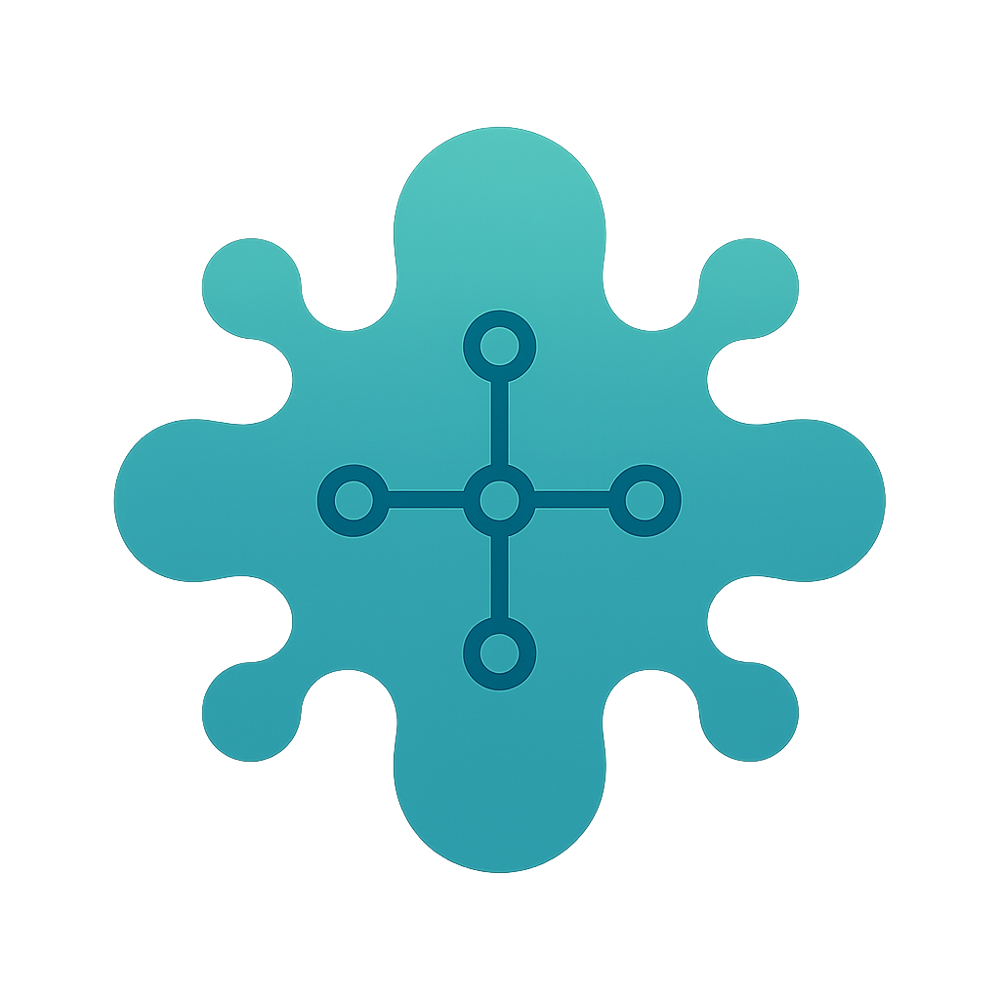

<p align="center">

</p>

<h1 align="center">Axus - Omnius P2P File Distribution (Work in Progress)</h1>

[](https://github.com/omnius-labs/axus/actions/workflows/ci.yml)

Axus is a peer-to-peer (P2P) file distribution system that runs on personal servers and PCs, designed to eliminate single points of failure in file discovery.

## Features

- **File Upload and Download**: Users can easily upload and download files, making data sharing effortless.
- **File Publishing and Subscription** (planned): Files are published under a signed Profile, so subscribers see who claims a file and how far their own Web of Trust trusts that author.
- **Bulletin Board Functionality** (planned): Provides a platform within the network for users to safely exchange and share information.

## Development

### Repository Setup

Please initialize the submodules right after cloning.

```sh
git submodule update --init
```

### Installing Required Dependencies

#### Debian and Ubuntu

```sh
sudo apt-get install -y libclang-dev
```
This package is required for RocksDB.

### Daemon Configuration

The daemon selects its configuration directory from `AXUS_DAEMON_CONFIG_DIR`, `~/.config/axus`, then `.config/axus`.
The selected directory must contain `axus.toml`.
The repository ships a development template as [axus.toml.example](./daemon/config/axus.toml.example); copy it before the first run:

```sh
cp daemon/config/axus.toml.example daemon/config/axus.toml
cargo run --manifest-path daemon/Cargo.toml -p omnius-axus-daemon -- start --config-dir daemon/config
```

The actual `axus.toml` is not tracked by git, so local paths and state do not enter the repository.

The `[p2p]` section accepts the following keys.

| Key | Default | Meaning |
| --- | --- | --- |
| `listen_addr` | required | `host:port` that accepts P2P connections |
| `advertise_addrs` | `[]` | `host:port` list announced to other nodes. When empty, the daemon announces `listen_addr`, or the reachable IPs with its port when `listen_addr` is unspecified such as `0.0.0.0` |
| `use_upnp` | `false` | Opens the listen port on the router through UPnP when `listen_addr` is unspecified |
| `bootstrap_nodes` | `[]` | `axus:node/...` URIs of nodes to connect to first |

The `[api]` section accepts the following keys.

| Key | Default | Meaning |
| --- | --- | --- |
| `listen_addr` | required | `host:port` of the REST API |
| `max_upload_size` | `0` | Largest declared publication size in bytes; `0` means no limit |

The `[storage]` section accepts the following key, and the `[web]` section follows it.

| Key | Default | Meaning |
| --- | --- | --- |
| `download_dir` | `<state_dir>/downloads` | Directory in which subscription outputs are placed |
| `library_roots` | `[]` | Directories a publication may read through a library source |
| `web.dir` | none | Build output of the browser client, served on the API's port |
| `web.insecure_cookie` | `false` | Drops `Secure` and the `__Host-` prefix so a LAN browser can log in over plain HTTP |

At startup the daemon logs its own URI as `node_profile` in the `node profile` message.
Add that URI to `bootstrap_nodes` of another daemon to connect the two.

### Browser Client

The browser client in [ui-web](./ui-web) is a static build that the daemon serves on the API's port.
Node.js and the OpenAPI type generator are managed with [mise](https://mise.jdx.dev/); run `mise install` in the repository root to install the versions pinned in `mise.toml` and `mise.lock`.

Build it and point `web.dir` at the output:

```sh
(cd ui-web && npm ci && npm run build)
```

```toml
[web]
dir = "/path/to/axus/ui-web/dist"
insecure_cookie = true # The daemon serves plain HTTP, and the browser needs this to keep the login cookie
```

Start the daemon and open the API's address, such as `http://127.0.0.1:5050/`.
The first visit asks for the owner name and a password; later visits ask for the login.
The API types are generated from [openapi.yaml](./daemon/openapi.yaml) and committed; run `npm run gen:api` in `ui-web/` after the contract changes, and commit the result.

For development, `npm run dev` serves the client with hot reload on its own port and proxies `/api` to `127.0.0.1:5050`, so run the daemon with that API address.

`npm run lint` checks the formatting and lint rules, and `npm run typecheck` checks the types.
`npm run test` runs the unit tests.
`npm run test:e2e` builds the client and runs the browser flow in Chromium: it starts two daemons, publishes on the first, and downloads on the second.
It needs the daemon binary, which defaults to `daemon/target/debug/omnius-axus-daemon` and can be set with `AXUS_DAEMON_BIN`, and a Chromium for Playwright, which `npx playwright install chromium` installs.
The transfer between the two daemons takes about a minute and a half.

### Linting

```sh
(cd daemon && cargo make lint)
```

### CI

The `ci` workflow runs on a pull request, on a push to `main` or `release/*`, and on a manual dispatch.
A change selects the jobs by the files it touches, and the `gate` job always reports, so it is the one check meant for branch protection.

| Change | Jobs |
| --- | --- |
| `daemon/**` | `daemon-lint`, `daemon-test`, `e2e` |
| `daemon/openapi.yaml` | `daemon-lint`, `daemon-test`, `ui`, `interface`, `e2e` |
| `ui-web/**`, `mise.toml`, `mise.lock` | `ui`, `e2e` |
| `.github/**` | Every job |
| Anything else, such as `docs/` | Only `changes` and `gate` |

A pull request runs the daemon tests on Linux, and a push to `main` or `release/*` runs them on Linux, macOS, and Windows.
A separate `dependency-audit` workflow runs weekly and on dependency changes; it is not part of the merge gate.
The design is in [ci.md](./docs/design/ci.md).

Run the same checks by hand:

```sh
(cd daemon && cargo make lint)
(cd daemon && cargo nextest run --all-features)
(cd ui-web && npm ci && npm run lint && npm run typecheck && npm run build && npm run test)
(cd ui-web && npm run gen:api && test -z "$(git status --porcelain -- src/api/schema.d.ts)")
(cd ui-web && npm run test:e2e)
bash daemon/entrypoints/gen-interface.sh && test -z "$(git status --porcelain -- daemon/entrypoints/interface)"
```

The tests of `omnius-core-migration::postgres` start a Postgres container, so they need a container runtime.

## Contributing

If you would like to contribute to this project, please contact us through [Issues](https://github.com/omnius-labs/axus/issues) or [Pull Requests](https://github.com/omnius-labs/axus/pulls) on GitHub.

## License

Axus is licensed under the [MIT License](LICENSE).

## Links

- Official Documentation: https://docs.omnius-labs.com/
