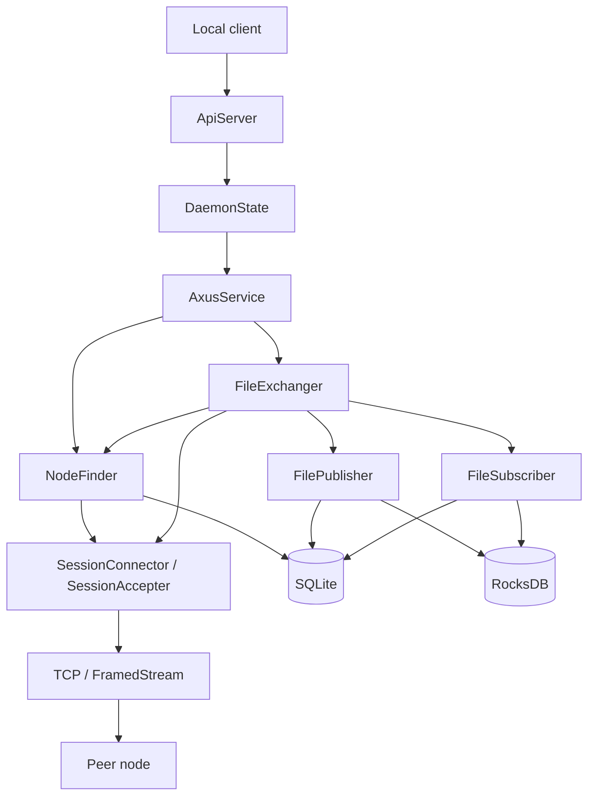

# Axus Design

## 1. About this document

This document covers the overall design of the Axus Rust daemon: how it discovers nodes over the P2P network and publishes and subscribes to files.
The main readers are developers who change the implementation under `daemon/` and AI agents who carry the design decisions forward.
This document assumes the vocabulary of [terms.md](./terms.md#2-terminology). Term definitions are not given here.

### 1.1 Division of responsibilities among documents

| Document or source of truth | Owns |
| --- | --- |
| This document | Scope of the whole project, overall structure, boundaries between concerns, cross-cutting design decisions, overall dependencies |
| [terms.md](./terms.md#2-terminology) | Definitions of project-specific terms, notation, and boundaries with adjacent terms |
| [issues.md](./issues.md) | Clear bugs confirmed in the code and their tracking until fixed |
| [knowledge.md](./knowledge.md) | Confirmed, sourced external knowledge about depends and the OS |
| [plans.md](./plans.md) | List of in-progress implementation plans and their dependencies |
| [reviews.md](./reviews.md) | History of reviews and the transcription state of their findings |
| [daemon-api.md](./design/daemon-api.md#1-about-this-document) | Lifecycle of the daemon, configuration boundaries, REST API, and OpenAPI generation |
| [rocketpack.md](./design/rocketpack.md#1-about-this-document) | Generation of RocketPack types, migration conventions of the wire format |
| [session.md](./design/session.md#1-about-this-document) | transport, Session establishment, use separation, shutdown |
| [node-finder.md](./design/node-finder.md#1-about-this-document) | Node lookup, information propagation, distance calculation, lookup state |
| [file-transfer.md](./design/file-transfer.md#1-about-this-document) | Publishing and subscribing to files, Merkle structure, output reservation, block exchange protocol, block verification |
| [storage.md](./design/storage.md#1-about-this-document) | Persistence of metadata, blocks, and output files, finalization and reclamation, recovery after failure, migration |
| [trust-security.md](./design/trust-security.md#1-about-this-document) | Authentication, encryption, content verification, identity, Web of Trust |
| [profile-memo.md](./design/profile-memo.md#1-about-this-document) | Responsibility boundary between Profile and memo; the public data they reference |
| [rust.md](./coding/rust.md) | Rust coding conventions. The canonical is in core-rs |
| [README.md](../README.md) | Project overview, setup, development procedures |
| [openapi.yaml](../daemon/openapi.yaml) | REST API paths, schemas, and status codes |
| [entrypoints/interface](../daemon/entrypoints/interface) | Rust interface generated from OpenAPI |
| `.rpf` files | Definitions of types and field numbers encoded with RocketPack |
| [Rust sources](../daemon) | Byte-level formats, constants, dependency versions |

This document does not hold an exhaustive API list, the RocketPack field numbers, setup procedures, or known bugs.
The generated `entrypoints/interface` is subject to review but is not an edit target for design changes.

### 1.2 Tenses used in this document

The body describes, in the present tense, the design that Axus satisfies.
The implementation status is consolidated in each detailed design document's "Current status and remaining work" section.
To find out what runs now, read §6 first; for concern-specific details, read the "Current status and remaining work" section of the corresponding detailed document.

## 2. What the Axus daemon is

Axus is a P2P file distribution service that runs on personal servers and PCs.
It is developed as open source, with the aims of enabling safe and cheap file sharing between individuals and removing the single point of failure in BitTorrent search.
The daemon combines, in one process, one node's network connections, node lookup, file encoding and decoding, persistent state, and the REST API for local clients.

### 2.1 Out of scope

- The GUI that operates the daemon and its screen transitions are not covered.
- The operational infrastructure, including distribution, monitoring, and backup, is not covered.
- The internal design of `core-rs` is not covered; only the contract as seen from Axus is.
- The complete wire format of the REST API and RocketPack is left to each source of truth.

Keeping these out of scope means the design documents carry no client UI, deployment topology, or copies of externally defined formats.

## 3. Overall structure

### 3.1 Components and directory map

| Path | package | Role |
| --- | --- | --- |
| [daemon/entrypoints/daemon](../daemon/entrypoints/daemon) | `omnius-axus-daemon` | CLI, configuration, process lifecycle, REST API implementation |
| [daemon/entrypoints/interface](../daemon/entrypoints/interface) | `omnius-axus-interface` | axum router and types generated from OpenAPI; not edited by hand |
| [daemon/modules/engine](../daemon/modules/engine) | `omnius-axus-engine` | Session, node lookup, file transfer, persistence |
| [daemon/refs/core-rs](../daemon/refs/core-rs) | `omnius-core-*` | Shared foundations: time, IDs, signatures, serialization, migration |

`daemon/` is the root of the Cargo workspace and builds the required core-rs crates directly as workspace members.

### 3.2 Flow of processing

Responsibilities are passed one-way from the client down to P2P communication.

The API layer knows the engine, but NodeFinder does not know FilePublisher or FileSubscriber and returns only lookup results.
This dependency direction lets the lookup rules and the file semantics change independently.

## 4. Design details

| Concern | Owning design document | Boundary with other concerns |
| --- | --- | --- |
| daemon and REST API | [daemon-api.md](./design/daemon-api.md#1-about-this-document) | Owns the engine and external contracts; no P2P protocol |
| RocketPack types | [rocketpack.md](./design/rocketpack.md#1-about-this-document) | Source of truth for wire types; no compiler internal design |
| transport and Session | [session.md](./design/session.md#1-about-this-document) | Authenticates connections and hands them to a use; does not interpret lookup or file messages |
| NodeFinder | [node-finder.md](./design/node-finder.md#1-about-this-document) | Handles the AssetKey-to-NodeProfile mapping; does not interpret file content |
| Publishing and subscribing to files | [file-transfer.md](./design/file-transfer.md#1-about-this-document) | Publishes, subscribes to, and verifies blocks; no lookup algorithm |
| Persistence | [storage.md](./design/storage.md#1-about-this-document) | Persists metadata, blocks, and output files and recovers them; no higher-level protocol |
| trust and security | [trust-security.md](./design/trust-security.md#1-about-this-document) | Defines the guarantees and limits of each layer; does not choose individual cryptographic protocols |
| Profile and memo | [profile-memo.md](./design/profile-memo.md#1-about-this-document) | Handles referencing and distributing higher-level data; does not interpret post bodies or block transfer |

## 5. Design decisions

### 5.1 Decided

#### Separate lookup from file transfer

**Decision**
NodeFinder looks up a NodeProfile for an AssetKey, and FileExchanger uses the result to exchange blocks.

**Rationale**
To keep the dependency direction in which the lookup algorithm does not know the file format, and the publisher and subscriber do not know DHT messages.

### 5.2 Deferred

There are no project-wide deferred decisions.
Concern-local deferred decisions live in the "Design decisions" sections of each detailed design document.

## 6. Current status and remaining work

### 6.1 Current status

Each detailed design document is the source of truth for the implementation status of its concern.
Overall, the daemon startup path owns down to FileExchanger and connects to other daemons starting from the configured bootstrap nodes, but the REST API that starts file publishing and subscription is not defined, so the end-to-end path is not complete.
From file publishing to decoding, including P2P transfer between daemons over loopback TCP, is confirmed by engine-internal tests.

### 6.2 Roadmap

The following order is tentative; only the dependencies in the table must be preserved.

| # | Item | Prerequisite dependency |
| --- | --- | --- |
| 1 | Define the REST API for publish, subscribe, progress, and cancel | Judgment on long-running operations and reach in [daemon-api.md](./design/daemon-api.md#52-deferred) |
| 2 | Define Web of Trust, Profile, and memo in order | [trust-security.md](./design/trust-security.md#4-design-decisions) |

For confirmed bugs and fix directions, see [issues.md](./issues.md).
