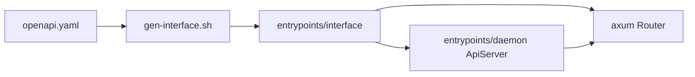

# Design of the daemon and API layer

## 1. About this document

This document covers the lifecycle of the daemon process, the configuration boundaries, the REST API contract, and the boundary of generated artifacts.
Term definitions are the source of [terms.md](../terms.md).

### 1.1 Division of responsibilities among documents

| Document or source of truth | Owns |
| --- | --- |
| [design.md](../design.md#11-division-of-responsibilities-among-documents) | Overall structure, boundaries with other concerns, cross-cutting dependencies |
| This document | Ownership in the daemon, configuration boundaries, and the design of the REST API and generation |
| [openapi.yaml](../../daemon/openapi.yaml) | REST API paths, schemas, and status codes |
| [entrypoints/interface](../../daemon/entrypoints/interface) | Rust interface generated from OpenAPI |
| [entrypoints/daemon](../../daemon/entrypoints/daemon) | daemon implementation |

### 1.2 Tenses used in this document

The body describes the completed design.
The implementation status and remaining work are consolidated in §6.

## 2. Responsibilities and boundaries

The daemon owns the engine, manages startup and shutdown, and provides a REST API to local clients.
The semantics of the P2P transport, lookup, and the file protocol belong to their respective design documents.

## 3. Process lifecycle

[Executor](../../daemon/entrypoints/daemon/src/executor.rs) decides the configuration directory, reads the configuration, creates `core.state_dir`, and acquires `axus.lock` in it.
This lock prevents multiple daemons using the same persistent state.
Then it initializes logging, constructs [DaemonState](../../daemon/entrypoints/daemon/src/state.rs), and starts [ApiServer](../../daemon/entrypoints/daemon/src/server.rs).
SIGINT and SIGTERM are converted to a common cancellation token, and the HTTP server and engine shutdowns are managed at the same process boundary.

DaemonState holds the daemon's owned objects and, at shutdown, stops the lower-level tasks starting from `AxusService::shutdown()`.
Keeping ownership and stop order in the same hierarchy prevents background tasks from being left behind.

## 4. Configuration and OpenAPI generation

### 4.1 Configuration boundaries

[config.rs](../../daemon/entrypoints/daemon/src/config.rs) converts the location of the persistent state, the listen address, the addresses advertised to other nodes and UPnP use, the bootstrap nodes to connect to at startup, and logging from the external configuration into internal types.
Because the HTTP API and the P2P transport are separate listen points, their addresses must be configurable separately.
The temporary directory follows the process lifetime; information needed after a restart lives under `state_dir`.

The source of truth for the configuration file name, defaults, and CLI options is the README and the code.
This document only prescribes not mixing the API and P2P settings and separating persistent state from temporary state.

### 4.2 Code generation from OpenAPI

The REST API makes [openapi.yaml](../../daemon/openapi.yaml) the source of truth for the contract and separates generated artifacts from hand-written implementation.

Regenerating the artifacts from scratch is a precondition, so API changes are made only in the OpenAPI and the handler implementation.
This boundary prevents discrepancies from hand-editing the schema and the router.

## 5. Design decisions

### 5.1 Decided

#### OpenAPI is the source of truth for the REST contract

**Decision**
The REST API paths, schemas, and status codes are defined in `openapi.yaml`, and the Rust interface is generated.

**Rationale**
To avoid a state where the schema, the router, and the client have separate definitions, and to concentrate changes into a single place.

**Rejected**
Directly editing the generated interface is not adopted because regeneration would lose it and would make the OpenAPI and the implementation diverge.

### 5.2 Deferred

#### Representation of long-running REST operations

**Current state**
Encoding, fetching, and decoding a file are long-running operations with internal state, and how to map them onto the external API is not decided.

The candidates are the following two.

1. Creating a job resource and polling it is resilient to reconnection, but requires a job retention period and a cancel contract.
2. Streaming progress as a stream or server-sent events is immediate, but requires rules for resuming after disconnection.

**Why not decided yet**
Because there is no external contract to stabilize until FilePublisher's and FileSubscriber's public operations are wired to the daemon layer.

**Decision condition**
Decide before adding the endpoints for starting a publish, starting a subscription, and fetching progress to `openapi.yaml`.

#### Reach and authentication of the REST API

**Current state**
The REST API has no authentication, and the health endpoint in `openapi.yaml` has `security: []`.
The listen address can be freely chosen with the `api.listen_addr` setting, and the daemon does not enforce the premise that only local clients connect.

The candidates are the following two.

1. Forcing a loopback-only listen address removes the need for authentication, but clients on another machine cannot operate it.
2. Adding authentication such as a token frees the listen address, but requires procedures for issuing and storing the token.

**Why not decided yet**
Because there are no state-changing endpoints, and nothing other than health needs to be protected.

**Decision condition**
Decide before adding the first state-changing endpoint, such as publish or subscribe, to `openapi.yaml`.

## 6. Current status and remaining work

Executor assembles the config, file lock, signal handling, and HTTP server, and DaemonState owns AxusService and manages it until shutdown.
The API and P2P have separate listen addresses, and the health handler reports that the daemon is running.
The endpoints for publishing files, subscribing, progress, and cancel are not defined.

For confirmed bugs, see [issues.md](../issues.md).