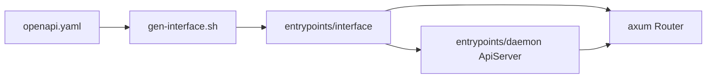

# Design of the daemon and API layer

## 1. About this document

This document covers the lifecycle of the daemon process, the configuration boundaries, the REST API contract, and the boundary of generated artifacts.
Term definitions are the source of [terms.md](../terms.md).

### 1.1 Division of responsibilities among documents

| Document or source of truth | Owns |
| --- | --- |
| [design.md](../design.md#11-division-of-responsibilities-among-documents) | Overall structure, boundaries with other concerns, cross-cutting dependencies |
| This document | Ownership in the daemon, configuration boundaries, and the design of the REST API and generation |
| [openapi.yaml](../../daemon/openapi.yaml) | REST API paths, schemas, and status codes |
| [entrypoints/interface](../../daemon/entrypoints/interface) | Rust interface generated from OpenAPI |
| [entrypoints/daemon](../../daemon/entrypoints/daemon) | daemon implementation |

### 1.2 Tenses used in this document

The body describes the completed design.
The implementation status and remaining work are consolidated in §6.

## 2. Responsibilities and boundaries

The daemon owns the engine, manages startup and shutdown, and provides a REST API to local clients.
The semantics of the P2P transport, lookup, and the file protocol belong to their respective design documents.

## 3. Process lifecycle

[Executor](../../daemon/entrypoints/daemon/src/executor.rs) decides the configuration directory, reads the configuration, creates `core.state_dir`, and acquires `axus.lock` in it.
This lock prevents multiple daemons using the same persistent state.
A lock file left by a dead process is removed at startup and acquisition is retried.
Then it initializes logging, constructs [DaemonState](../../daemon/entrypoints/daemon/src/state.rs), and starts [ApiServer](../../daemon/entrypoints/daemon/src/interface/server.rs).
SIGINT and SIGTERM are converted to a common cancellation token, and the HTTP server and engine shutdowns are managed at the same process boundary.

DaemonState holds the daemon's owned objects and, at shutdown, stops the lower-level tasks starting from `AxusService::shutdown()`.
Keeping ownership and stop order in the same hierarchy prevents background tasks from being left behind.

## 4. Configuration and OpenAPI generation

### 4.1 Configuration boundaries

[config.rs](../../daemon/entrypoints/daemon/src/config.rs) converts the location of the persistent state, the listen address, the addresses advertised to other nodes and UPnP use, the bootstrap nodes to connect to at startup, and logging from the external configuration into internal types.
Because the HTTP API and the P2P transport are separate listen points, their addresses must be configurable separately.
The temporary directory follows the process lifetime; information needed after a restart lives under `state_dir`.
`api.max_upload_size` is the maximum declared upload size in bytes, and `0` means unlimited; the default is `0`.

The source of truth for the configuration file name, CLI options, and settings not described here is the README and the code.
This document prescribes the API upload-size contract and the separation of API and P2P settings and of persistent state from temporary state.

### 4.2 Code generation from OpenAPI

The REST API makes [openapi.yaml](../../daemon/openapi.yaml) the source of truth for the contract and separates generated artifacts from hand-written implementation.

Regenerating the artifacts from scratch is a precondition, so API changes are made only in the OpenAPI and the handler implementation.
This boundary prevents discrepancies from hand-editing the schema and the router.

## 5. Design decisions

### 5.1 Decided

#### OpenAPI is the source of truth for the REST contract

**Decision**
The REST API paths, schemas, and status codes are defined in `openapi.yaml`, and the Rust interface is generated.

**Rationale**
To avoid a state where the schema, the router, and the client have separate definitions, and to concentrate changes into a single place.

**Rejected**
Directly editing the generated interface is not adopted because regeneration would lose it and would make the OpenAPI and the implementation diverge.

#### Long-running REST operations are domain resources

**Decision**
Publish and subscribe are exposed as domain resources at `/publishes/{id}` and `/subscribes/{id}`.
Creating a publish returns `201` with the `Uploading` resource, and its commit returns `202` when encoding starts.
Starting a subscription returns `202` with the resource.
Progress is read from the same resource, and cancel and remove are operations on it.
A `Failed` publish is removed by cancel or remove; the API does not retry it.
A generic operation resource is not introduced.
The publisher records every publish ID that reached the committed file, so each resource ID stays readable after commit, including when the same file is published again.

**Rationale**
A publish and a subscription are persistent tasks with their own IDs and state, unlike a copy or a move that has no natural resource.
Keeping the task state and the resource state in one place avoids a second identifier and a separate retention rule.

**Rejected**
A generic operation registry duplicates the task IDs and needs its own expiry.
Streaming progress as a stream or server-sent events needs reconnection rules before the resource model is stable.

#### Uploads and downloads are part of the publish and subscribe resources

**Decision**
A publish is created first, its content is written to `PUT /publishes/{id}/content`, and `POST /publishes/{id}/commit` starts encoding.
A completed subscription is read with `GET /subscribes/{id}/content`.
Upload and download sessions are not separate resources.

**Rationale**
The publish resource owns the upload from creation to commit, and the subscription owns the output from start to download.
One ID per client intent avoids mapping an upload ID to a publish ID.

**Rejected**
A separate upload resource requires an ID mapping and a second retention rule.
A separate download session adds state that HTTP Range already covers.
A publish from a server-side path would let a client name any file on the daemon host, so the API accepts only uploaded content.

#### API state names are a stable mapping of engine states

**Decision**
The API exposes the following states and does not expose the engine's `Unknown` state.

| API state | Engine state or record |
| --- | --- |
| `Uploading` | The API's in-memory upload state |
| `Pending` | `PublishedUncommittedFileStatus::Pending` |
| `Processing` | `PublishedUncommittedFileStatus::Processing` |
| `Succeeded` | A committed file with the publish ID |
| `Failed` | `PublishedUncommittedFileStatus::Failed` |
| `Downloading` | `SubscribedFileStatus::Downloading` |
| `Decoding` | `SubscribedFileStatus::Decoding` |
| `Finalizing` | `SubscribedFileStatus::Finalizing` |
| `Completed` | `SubscribedFileStatus::Completed` |
| `Canceled` | `SubscribedFileStatus::Canceled` |

**Rationale**
The engine state names change with the storage model, while a client polls one contract.
The mapping keeps the names that already describe the task and renames only the publisher's terminal state, where the engine has no row after commit.

**Rejected**
Returning the raw engine enum exposes `Unknown` and makes a storage change a client-visible change.

#### The REST API is local-only and unauthenticated

**Decision**
The REST API is intended for local clients and has no authentication.
The daemon warns when `api.listen_addr` is not a loopback address but does not reject it.

**Rationale**
The daemon runs on the owner's machine and the API controls files on that machine.
Adding a user and session store before a remote client exists would add state that nothing uses.

**Rejected**
Rejecting a non-loopback address removes the owner's choice to bind a private interface deliberately.
A static token adds a secret to the configuration without an issuance or rotation procedure.

#### Uploading state is kept in memory until commit

**Decision**
From publish creation to commit, the upload state (staged path, declared size, written size, and expiry) is kept in daemon memory and disappears on restart.
The staging file lives under `core.state_dir/uploads`, and the daemon removes that directory at startup.
An upload that stays idle for 24 hours is removed with its staging file.
The publish ID is issued by the API and passed to the engine at commit, so the engine row keeps the same ID after commit.

**Rationale**
The upload is a short-lived transfer before any engine row exists.
Persisting it would add a second state machine for a case where a restart already interrupts the client connection.
The fixed 24-hour lifetime bounds the disk a client can reserve without making the client configure a second timeout.

**Rejected**
Persisting the upload state in the engine lets a client resume after restart, but adds an `Uploading` state and a staging-file recovery path to the publisher store.

#### The engine owns the staged source of an uploaded publish

**Decision**
At commit, the engine moves the staged file into its own source directory and deletes it when the publish reaches commit, cancel, or failure.
A source file left by a crash is swept at startup.

**Rationale**
The TaskEncoder reads the source asynchronously after commit, so the API cannot delete it at commit.
The engine already knows when the publish ends and can make the deletion durable.

**Rejected**
The API could track the source until the task ends, but a restart loses the mapping and leaks the file.

### 5.2 Deferred

There are no deferred decisions.

## 6. Current status and remaining work

Executor assembles the config, file lock, signal handling, and HTTP server, and DaemonState owns AxusService and manages it until shutdown.
The API and P2P have separate listen addresses, and the health handler reports that the daemon is running.
The daemon implements the publish and subscribe resources of §5.1: upload content, commit, get, list, cancel, and remove for a publish, and create, get, list, cancel, remove, and download content for a subscribe.
The generated router serves the JSON endpoints, and the two content paths are hand-written routes because the generated router cannot stream a request or response body.
The upload state is kept in daemon memory under `core.state_dir/uploads`, and the daemon removes that directory at startup.
A completed publish keeps its publish ID in the publisher's publish records, so `GET /publishes/{id}` remains readable after commit and after a restart, including when the same file is published again.
The API is local-only and unauthenticated; a non-loopback `api.listen_addr` logs a warning.
The design decisions above are implemented, and there is no remaining work in this document.

For confirmed bugs, see [issues.md](../issues.md).
