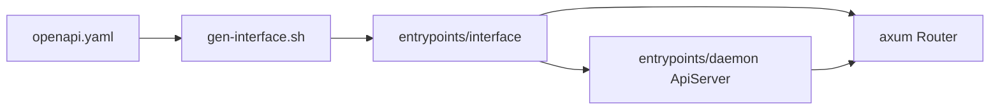

# Design of the daemon and API layer

## 1. About this document

This document covers the lifecycle of the daemon process, the configuration boundaries, the REST resources, the authentication of the client, the static serving of the browser client, and the boundary of the generated artifacts.
The main readers are developers who change the implementation under `daemon/` and AI agents that carry the decisions forward.
This document assumes the vocabulary of [terms.md](../terms.md#2-terminology). Term definitions are not given here.

### 1.1 Division of responsibilities among documents

| Document or source of truth | Owns |
| --- | --- |
| [design.md](../design.md#11-division-of-responsibilities-among-documents) | Overall structure, boundaries between concerns, cross-cutting dependencies |
| This document | Daemon lifetime, configuration boundaries, REST resources, authentication and sessions, static serving, reach |
| [web-client.md](./web-client.md#1-about-this-document) | Screens, routes, polling, and the build of the browser client |
| [file-transfer.md](./file-transfer.md#41-publisher-side) | Publisher and subscriber state transitions, the block exchange, block verification |
| [storage.md](./storage.md#2-responsibilities-and-boundaries) | Persistence of metadata, blocks, staged files, and output files |
| [openapi.yaml](../../daemon/openapi.yaml) | REST API paths, schemas, and status codes |
| [entrypoints/interface](../../daemon/entrypoints/interface) | Rust interface generated from OpenAPI; not edited by hand |
| [entrypoints/daemon](../../daemon/entrypoints/daemon) | Daemon implementation |

### 1.2 Tenses used in this document

The body describes the completed design, in the present tense.
The implementation status and the remaining work are consolidated in §10.
To check what runs now, read §10 first.

## 2. Responsibilities and boundaries

The daemon owns the engine, manages startup and shutdown, and serves the REST API and the build output of the browser client on one origin.
It owns the identity of the single operator, the session that proves it, and the reach of the API.
The semantics of the P2P transport, lookup, file transfer, and persistence belong to their respective design documents.

**The API never accepts a path on the host from a client.**
Every path it reads or writes is fixed by configuration, and a client chooses among them with an identifier the daemon issued (§8.2).
This premise keeps path validation out of every route and confines the filesystem surface to the configured directories.

## 3. Process lifecycle

[Executor](../../daemon/entrypoints/daemon/src/executor.rs) decides the configuration directory, reads the configuration, creates `core.state_dir`, and acquires `axus.lock` in it.
This lock prevents multiple daemons from using the same persistent state.
It then initializes logging, constructs [DaemonState](../../daemon/entrypoints/daemon/src/state.rs), opens the owner store, and starts [ApiServer](../../daemon/entrypoints/daemon/src/server.rs).
SIGINT and SIGTERM are converted to a common cancellation token, and the HTTP server and engine shutdowns are managed at the same process boundary.

DaemonState holds the daemon's owned objects and, at shutdown, stops the lower-level tasks starting from `AxusService::shutdown()`.
Keeping ownership and stop order in the same hierarchy prevents background tasks from being left behind.

## 4. Configuration and OpenAPI generation

### 4.1 Configuration boundaries

[config.rs](../../daemon/entrypoints/daemon/src/config.rs) converts the location of the persistent state, the listen addresses of the API and of the P2P transport, the directory that receives subscription outputs, the library roots a publication may read, the maximum size of an upload, the directory of the browser client's build output, the session cookie policy, the addresses advertised to other nodes and UPnP use, the bootstrap nodes to connect to at startup, and logging into internal types.
Because the HTTP API and the P2P transport are separate listen points, their addresses are configurable separately.
The temporary directory follows the process lifetime; information needed after a restart lives under `state_dir`.

The source of truth for the configuration file name, defaults, and CLI options is the README and the code.
This document prescribes only which settings exist, not their default values.

### 4.2 Code generation from OpenAPI

The REST API makes [openapi.yaml](../../daemon/openapi.yaml) the source of truth for the contract and separates generated artifacts from hand-written implementation.

Regenerating the artifacts from scratch is a precondition, so API changes are made only in the OpenAPI and the handler implementation.
This boundary prevents discrepancies from hand-editing the schema and the router.

## 5. REST resources

### 5.1 Publications and subscriptions as mirrors

The API has two transfer resources.
A publication sends bytes into the node and ends in a committed file.
A subscription brings bytes out of the network and ends in an output file.
They carry the same operations, and the following table fixes which operation exists on which resource.
The paths in this table name the design's resources; the authoritative path and schema of each operation are declared in [openapi.yaml](../../daemon/openapi.yaml).

| Operation | Publication | Subscription |
| --- | --- | --- |
| Create and start | `POST /publications` | `POST /subscriptions` |
| List | `GET /publications` | `GET /subscriptions` |
| Read | `GET /publications/{id}` | `GET /subscriptions/{id}` |
| Transfer bytes | `PUT /publications/{id}/content` | `GET /subscriptions/{id}/content` |
| Report progress | `receivedBytes` and `size` | `blockCountDownloaded` and `blockCountTotal` |
| Cancel | `POST /publications/{id}/cancel` | `POST /subscriptions/{id}/cancel` |
| Delete | `DELETE /publications/{id}` | `DELETE /subscriptions/{id}` |

**The mirror is a contract, not a naming preference.**
A resource that exists only on one side, such as a separate upload collection or a commit step, forces the client to carry two lifecycles and gives the API a staging concept that the other side does not have.
Both transfers are also durable rows, so a client that reconnects finds the same identity and resumes from the reported progress.
The library list of §5.3 is a read-only catalog of sources and has no transfer counterpart.

A publication has the following states.
A subscription has the states of [file-transfer.md §4.2](./file-transfer.md#42-subscriber-side).

| Publication state | Meaning | Terminal |
| --- | --- | --- |
| `Receiving` | The declared size is known and content bytes are still missing | no |
| `Pending` | All content bytes are present; encoding has not started | no |
| `Processing` | Encoding is running | no |
| `Committed` | The root hash is fixed and the file can be advertised | yes |
| `Failed` | Encoding stopped with a reason | yes |
| `Canceled` | Cancel was requested before the commit | yes |

The list of publications has one entry per committed file plus one entry per active publication.
A repeated import of the same content under the same name keeps its own publication ID readable, but does not add a second list entry; the entry is the oldest ID of that pair.
Deleting that entry removes the committed file and every ID of the pair.

### 5.2 Creating a publication and sending its content

`POST /publications` declares a source (§5.3) and returns the publication in its initial state: `Receiving` for an upload of nonzero size, and `Pending` for a library file or an empty upload.
An upload declares the file name and the final size; a library source declares a root and a relative path, and the daemon derives the name and size from the file.
A declared size above `api.max_upload_size` returns `413` before any byte is sent.
An empty upload therefore needs no content request.
The daemon allocates the publication ID at this point and reuses it as the identity of the import, so the ID does not change when the file commits.

The client sends the bytes with `PUT /publications/{id}/content`, carrying `Content-Range` with the offset it writes and the total size.
The daemon accepts a range only at the reported received offset.
A gap or an overlap returns `409` with the current `receivedBytes`, so the client rewinds to that offset and continues.
A request that would exceed the declared size returns `413`, and a full disk returns `507`.

The daemon advances the received offset after the write completes.
The offset is a hint, not the source of truth for the stored bytes: on restart the daemon reconciles it with the length of the staged file and rewinds the offset when the file is shorter.
A power loss therefore costs at most a resend from the reconciled offset, and a chunk write is not slower than the filesystem's normal write.

When the last byte arrives, the daemon moves the publication from `Receiving` to `Pending` and the encoder starts.
A publication that receives no bytes for 24 hours becomes `Canceled` with a reason, and its staged file is deleted.
A client that reconnects reads `receivedBytes` and continues.

### 5.3 Sources of a publication

A publication reads its content from exactly one of two sources.

- **Upload.** The client sends the bytes as in §5.2, and the daemon stages them under `state_dir/uploads`.
  The encoder reads the staged file after the last byte, and the staging file is deleted when the publication commits, is canceled, or fails.
- **Library.** The client names a configured library root and a path inside it, and the daemon reads that file in place.
  The file is not copied, so publishing a large file on the server costs one read and no additional disk space.

The library source treats the file as immutable for the duration of the import.
The daemon records the file's size and modification time before encoding and fails the publication with a reason if either differs when the encoding finishes.
Without this check a file edited during the import would commit a root hash that corresponds to neither version.
The same library file cannot be published twice at once: a second import of a path and name that is already `Receiving`, `Pending`, or `Processing` is rejected with `409`.

The daemon lists the roots and their entries so that the client chooses a file without typing a path.
`GET /library/roots` returns the configured roots with an opaque identifier that stays the same while the path remains configured, and `GET /library/roots/{rootId}/entries` lists one directory of a root with the name, kind, and size of each entry.
The listing is read-only and applies the same containment rules as the source path.

### 5.4 Creating a subscription and downloading its output

`POST /subscriptions` names a root hash and a file name and returns the subscription.
The daemon places the output at `storage.download_dir` joined with the file name; the client never names a directory.
`GET /subscriptions/{id}/content` serves the output after `Completed` with `Range` and `ETag`, so a large download resumes without a second resource.

`DELETE /subscriptions/{id}` removes the subscription row and leaves the placed output in place, because the output belongs to the operator once it is placed.
`DELETE /subscriptions/{id}?deleteOutput=true` also deletes the output file; the daemon refuses the request while the row is not terminal.

### 5.5 Cancellation and deletion

Cancellation and deletion are separate, and both resources behave the same way.

| Target state | `POST /{id}/cancel` | `DELETE /{id}` |
| --- | --- | --- |
| Active (`Receiving`, `Pending`, `Processing`, `Downloading`, `Decoding`) | Stops the work and makes the row `Canceled` | `409`; cancel first |
| `Finalizing` | `409`; placement is already running | `409` |
| Terminal (`Canceled`, `Failed`, `Committed`, `Completed`) | Returns the row unchanged | Removes the row; a committed publication also removes the committed file and every mapping to it |
| Unknown ID | `404` | `404` |

Keeping the canceled row makes the reason visible in the list and lets the client offer a retry, and it lets `DELETE` mean one thing on both resources.
Cancel on a terminal row changes nothing, so a client can repeat it safely.
Deleting any publication ID that maps to a committed file removes that file and all of its IDs, because the IDs are views of one advertised file.

### 5.6 Errors and status codes

Errors share one body with a `kind`, a message, and an optional request identifier.
The following statuses carry a convention that crosses resources; the per-path list is in [openapi.yaml](../../daemon/openapi.yaml).

| Status | When |
| --- | --- |
| `400` | A malformed request, an invalid file name, or an unknown source kind |
| `401` | The session is missing, expired, or revoked |
| `403` | A cookie request from another origin (§6.3) |
| `404` | The publication or subscription ID is unknown |
| `409` | An offset mismatch, a state that forbids the operation, or an import that is already active |
| `413` | Content beyond the declared size or beyond the configured limit |
| `507` | The destination has insufficient space |

### 5.7 Polling durable resources

Starting a publication or a subscription returns `202` and the resource.
The client polls the resource until it reaches a terminal state.
There is no job table and no retention period: the state comes from the row the engine persists, so a resource lives until it is deleted.

Streaming progress with server-sent events needs rules for resuming after a disconnection and gives the client nothing that polling a durable row does not.
It can be added beside the resources later without changing them.

## 6. Authentication and sessions

### 6.1 The single owner and the first-run setup

The daemon starts with no owner.
`GET /setup/status` reports whether one exists, and `POST /setup` registers it; after that, `POST /setup` returns `409`.
The existence check and the insert are one conditional statement, so two concurrent requests cannot create two owners.
The password is stored as an argon2id hash.

The first registration is accepted from any host that reaches the API.
An operator who exposes the port before registering lets the first visitor become the owner, and this is the one window the design accepts.
The daemon therefore warns when the listen address is not loopback, and the sample configuration binds loopback.

### 6.2 Session transport and storage

Authentication is by owner name and password, and a successful login creates a server-side session.
Neither a JWT nor a refresh token is used.

| Transport | Carried by | Stored in |
| --- | --- | --- |
| Cookie | `__Host-axus_session` (`Path=/`, `HttpOnly`, `Secure`, `SameSite=Strict`) | The browser |
| Bearer | `Authorization: Bearer <opaque>` | Native clients and scripts |

Both are opaque identifiers of the same server-side row, so their substance is the same.
The token is 32 random bytes and appears in plaintext only when it is handed to the client.
SQLite stores only the token's SHA3-256, and the lookup hashes the presented token the same way.

A session expires 30 days after creation and is not extended.
The last-used time is written at most once every 5 minutes, because writing it on every request would make the write load grow with the poll rate.
`DELETE /auth/session` expires the session.
Because the session is a row, a logout or an expiry takes effect on the next request, unlike a self-contained token.

`web.insecure_cookie = true` removes `Secure` and the `__Host-` prefix and names the cookie `axus_session`.
It exists because a browser on the LAN reaches the daemon over plain HTTP (§8.1); the daemon's default keeps the cookie secure, and the bundled sample turns the setting on.

### 6.3 Cross-origin requests

A request that carries a session cookie and uses a method other than `GET` or `HEAD` returns `403` unless its `Origin` is `http://` followed by `Host`.
The daemon serves plain HTTP (§8.1), so the scheme is part of the comparison and an `https` origin is rejected; a deployment that terminates TLS elsewhere needs a different rule (§9.2).
A cookie request without an `Origin` also returns `403`, so the check cannot be bypassed by omitting the header.
Bearer requests, login, and setup are not subject to this check.

`SameSite=Strict` and this check replace a CSRF token.
Both depend on the client being served from the same origin (§7.1): a client on another origin would need CORS with credentials, an origin allowlist, and a different CSRF argument.
A page on another origin cannot read the cookie or the response, so the check is defense in depth rather than the only guard.
`Host` itself is not validated, so a request that reaches the daemon under another name is treated as the same origin; the cookie is host-only, which keeps such a page from carrying it.

## 7. Serving the browser client

### 7.1 Same-origin static serving

When `web.dir` is set, a path outside `/api` returns a file from that directory and falls back to `index.html`.
A path under `/api` without a route returns the API's `404`, so a client typo does not silently receive the HTML shell.
A URL path with a `..` component falls back to `index.html` instead of reaching a file above the directory.
A symbolic link inside the directory is followed, because the operator controls what the directory contains.

Serving the client from the same origin removes CORS from the design and is the premise of §6.3.

### 7.2 Build output

The daemon serves a build output; it does not run a bundler.
The build procedure, the development proxy, and the directory layout belong to [web-client.md §5](./web-client.md#5-build-and-development).

## 8. Reach and paths

### 8.1 Plain HTTP on the LAN and a VPN outside it

The daemon does not terminate TLS.
Inside the LAN it serves plain HTTP, and from outside the LAN the operator reaches it through a VPN such as Tailscale.
`api.listen_addr` accepts any address, but the sample configuration binds `127.0.0.1`.
TLS termination, certificate issuance, and reverse-proxy configuration are out of scope.

Plain HTTP has three consequences that the design accepts.
The browser needs `web.insecure_cookie` to log in (§6.2).
The client cannot be installed as a PWA, because a service worker requires a secure context.
Credentials and content are visible to anything that can observe the LAN traffic.

### 8.2 The directories and names the API touches

| Setting | Access | What a client may choose |
| --- | --- | --- |
| `core.state_dir` | read and write | Nothing; the daemon's own state, including staged content |
| `storage.download_dir` | write | A file name, not a path |
| `storage.library_roots` | read | A root identifier and a relative path |
| `web.dir` | read | A URL path, under the rules of §7.1 |

A subscription's file name must be a single path component: no separator, no `.` or `..`, not an absolute path, not a reserved temporary-output name ([storage.md §4.5](./storage.md#45-output-finalization-and-recovery)), and within the filesystem's length limit.
Case and Unicode-normalization conflicts between two names are detected when the output is placed, not at registration.

A library path must name a configured root and a relative path inside it.
The daemon rejects an absolute path and a `..` component, resolves the path, and rejects it when the result leaves the root.
A symbolic link is followed only when its target stays inside the root; a link that leaves it is rejected, and a target outside the root must be configured as its own root.
The file must be a regular file.

The validation and the open are separate, so a file can be replaced between them.
The operator controls the directories and is the only account, so this race is between the operator and themselves; the checks exist to contain mistakes, not to defend against another account.

## 9. Design decisions

### 9.1 Decided

#### OpenAPI is the source of truth for the REST contract

**Decision**
The REST API paths, schemas, and status codes are defined in `openapi.yaml`, and the Rust interface and the client's types are generated from it.

**Rationale**
To avoid a state where the schema, the router, and the client have separate definitions, and to concentrate changes into a single place.

**Rejected**
Directly editing the generated interface is not adopted because regeneration would lose it and would make the OpenAPI and the implementation diverge.

#### Mirror publications and subscriptions as one resource shape

**Decision**
A publication and a subscription expose the same operations: create, list, read, transfer bytes, report progress, cancel, and delete.
Neither side has an operation the other lacks.

**Rationale**
The client carries one lifecycle per transfer and learns one set of rules.
A resource that exists on one side only makes the client special-case that side and hides a transport accident in the domain model.

**Rejected**
A separate upload collection beside the publications, which was the shape of the rejected browser API, gives the API two ways to create a publication, a second in-memory lifecycle that disappears on restart, and an operation with no counterpart.
A job resource that only reports progress duplicates the state the engine already persists.

#### Send content as a sub-resource and commit on the last byte

**Decision**
`POST /publications` declares the name and size, `PUT /publications/{id}/content` carries the bytes at an offset, and the daemon commits when the received size reaches the declared size.
There is no commit endpoint.

**Rationale**
One code path serves a small file and a large one, and a commit endpoint that the subscription side does not have would break the mirror.
The declared size makes the commit decision a comparison rather than a client promise.

**Rejected**
A single request that carries the whole body cannot resume after a disconnection and forces a second path above a size threshold; the rejected browser API had both paths and both limits.
An explicit commit endpoint lets a client stop early, but the declared size already expresses that, and the subscription side has no equivalent.

#### Read content from a staged upload or a library file

**Decision**
A publication source is either an upload, which the daemon stages under `state_dir/uploads`, or a file inside a configured library root, which the daemon reads in place.

**Rationale**
A browser cannot send a path, and a large file that already lives on the server should not travel to the client and back.
Confining library reads to configured roots keeps every path the API touches under configuration.

**Rejected**
A client-supplied absolute path, which the rejected local API accepted as `outputPath`, gives the API a read and write surface over the whole host for no capability that a configured root and a relative path do not provide.
Upload only forces a copy of every server-side file through the client.

#### Require one owner with a server-side session

**Decision**
The daemon has exactly one owner, registered on first run, and every route except health, setup, and login requires a session.
Health stays unauthenticated so a monitor can check liveness without a credential.
The session is an opaque server-side row carried by a cookie or a bearer token.

**Rationale**
The node is operated from another device on the LAN, where anything that reaches the port can change or delete data.
A server-side row can be revoked and expired immediately, and one identity keeps the model small.

**Rejected**
No authentication, which the rejected browser API chose, lets any host on the LAN delete publications and download outputs, and leaves DNS rebinding and a shared browser as the only guards.
A single long-lived token would work without a database but cannot be revoked, leaks through logs and copied URLs, and changes the contract when a second identity is needed.
Accounts, roles, and sharing are out of scope (§2.1 of [design.md](../design.md#21-out-of-scope)).

#### Reject a cookie request from another origin

**Decision**
A state-changing request that carries a session cookie must present the origin `http://` followed by `Host`.
Bearer requests are exempt.

**Rationale**
The browser sends the cookie automatically, so the origin is the only thing that distinguishes the operator's page from another site's page.
`SameSite=Strict` covers the common case and the check covers the rest.

**Rejected**
A CSRF token adds a second secret and a token lifecycle for a client that is always served from the same origin.
An origin allowlist needs configuration per name the operator reaches the daemon by.

#### Serve the browser client from the API's origin

**Decision**
When `web.dir` is set, the daemon serves the client's build output on the API's port.

**Rationale**
The same origin needs no CORS rule, and it is what makes the cross-origin check in §6.3 meaningful.

**Rejected**
Serving the client from another origin requires CORS with credentials and a way to tell the daemon which origins to trust.

#### Bound the reach with the network, not with TLS in the daemon

**Decision**
The daemon serves plain HTTP, binds loopback by default, and leaves the network boundary to the operator: a VPN from outside the LAN, and no TLS in this design.

**Rationale**
Certificate issuance, renewal, and distribution are a separate operation with its own failure modes, and the operator already needs a network boundary for a personal node.

**Rejected**
TLS termination inside the daemon adds a certificate store and a renewal path to a process whose job is file transfer.
Requiring a reverse proxy for every deployment blocks the loopback-only case, which is the simplest one.

#### Poll durable resources instead of streaming progress

**Decision**
A long-running operation is a resource that the client polls until a terminal state.

**Rationale**
The engine persists the state and resumes after a restart, so the resource cannot disagree with the work, and polling has no resume rule to define.

**Rejected**
Server-sent events need a resume contract and a retention rule, and they give the client nothing that a poll of the same row does not.

#### Serve an output as an opaque attachment

**Decision**
`GET /subscriptions/{id}/content` answers `application/octet-stream` with `Content-Disposition: attachment` and `X-Content-Type-Options: nosniff`.

**Rationale**
An output is untrusted content from the network and shares its origin with the client and the API; rendered as HTML, a script in it could drive the API.

**Rejected**
Guessing the media type from the file name would let a browser render the file in the API's origin.

#### Let handwritten routes carry file bytes

**Decision**
The routes that carry file bytes are declared in `openapi.yaml` and implemented by handwritten routes in front of the generated router.

**Rationale**
The generated routes take a request body as `Bytes` and build a response body in memory, which neither a large upload nor a large download should do.

**Rejected**
Declaring the byte routes only in code leaves clients without a contract for them.

#### Hide the block size, attributes, and priority from the API

**Decision**
The daemon publishes with the largest block size and without attributes, and starts every import and subscription at the same priority.

**Rationale**
A client has no basis to choose them yet, and each can be added as an optional field without breaking the contract.

### 9.2 Deferred

#### Node information and share links in the REST API

**Current state**
The API exposes neither the node's profile and connections nor a link format for sharing a root hash and a file name.
A publication is shared as text: the root hash and the file name, which the recipient enters in their own node.

**Why not decided yet**
What a node screen must show depends on the client's screens, and the first client only needs the text pair.

**Decision condition**
Decide when a client screen shows the node's connections or when a share link is requested by a user.

#### Streaming progress

**Current state**
The client polls the resource, and the resources carry progress fields.

**Why not decided yet**
Polling a durable row is enough for the transfer sizes and the LAN reach of the first client.

**Decision condition**
Decide when the observed poll interval cannot show progress at the rate the client needs, or when a transfer lasts long enough that the poll load on the daemon is measurable.

#### Multiple operators and roles

**Current state**
The daemon has one owner and no role or permission model.

**Why not decided yet**
The node is a personal node, and the first client has no screen that another person operates.

**Decision condition**
Decide when a second person must operate the same node, such as a household member or a shared server.

#### HTTPS through a reverse proxy

**Current state**
The daemon serves plain HTTP, the origin check expects the `http` scheme, and the session cookie carries `Secure` only when `web.insecure_cookie` is false.

**Why not decided yet**
TLS termination and reverse-proxy configuration are out of scope (§2.1 of [design.md](../design.md#21-out-of-scope)).

**Decision condition**
Decide when a deployment must serve HTTPS to a browser; the origin rule, the secure cookie flag, and the listener's forwarded headers must be decided together.

## 10. Current status and remaining work

Executor assembles the config, file lock, signal handling, and HTTP server, and DaemonState owns AxusService and manages it until shutdown.
The API and P2P have separate listen addresses.
The publication and subscription resources, the staged upload, the download directory, the static serving, the owner and session, and the configuration settings described in this document are implemented.
A transfer from an upload on one daemon to a download on another, and the setup, login, cookie, bearer, and origin checks, are confirmed through the router tests.
The library source and the browser client are not implemented.

For confirmed bugs, see [issues.md](../issues.md).
