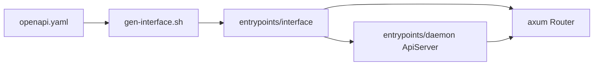
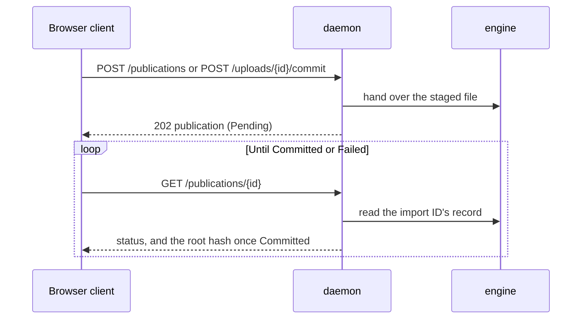

# Design of the daemon and API layer

## 1. About this document

This document covers the lifecycle of the daemon process, the configuration boundaries, the REST API contract, and the boundary of generated artifacts.
Term definitions are the source of [terms.md](../terms.md).

### 1.1 Division of responsibilities among documents

| Document or source of truth | Owns |
| --- | --- |
| [design.md](../design.md#11-division-of-responsibilities-among-documents) | Overall structure, boundaries with other concerns, cross-cutting dependencies |
| This document | Ownership in the daemon, configuration boundaries, and the design of the REST API and generation |
| [openapi.yaml](../../daemon/openapi.yaml) | REST API paths, schemas, and status codes |
| [entrypoints/interface](../../daemon/entrypoints/interface) | Rust interface generated from OpenAPI |
| [entrypoints/daemon](../../daemon/entrypoints/daemon) | daemon implementation |

### 1.2 Tenses used in this document

The body describes the completed design.
The implementation status and remaining work are consolidated in §6.

## 2. Responsibilities and boundaries

The daemon owns the engine, manages startup and shutdown, provides a REST API, and serves a browser client from the same port.
The semantics of the P2P transport, lookup, and the file protocol belong to their respective design documents.

## 3. Process lifecycle

[Executor](../../daemon/entrypoints/daemon/src/executor.rs) decides the configuration directory, reads the configuration, creates `core.state_dir`, and acquires `axus.lock` in it.
This lock prevents multiple daemons using the same persistent state.
Then it initializes logging, constructs [DaemonState](../../daemon/entrypoints/daemon/src/state.rs), and starts [ApiServer](../../daemon/entrypoints/daemon/src/server.rs).
SIGINT and SIGTERM are converted to a common cancellation token, and the HTTP server and engine shutdowns are managed at the same process boundary.

DaemonState holds the daemon's owned objects and, at shutdown, stops the lower-level tasks starting from `AxusService::shutdown()`.
Keeping ownership and stop order in the same hierarchy prevents background tasks from being left behind.

## 4. Configuration and OpenAPI generation

### 4.1 Configuration boundaries

[config.rs](../../daemon/entrypoints/daemon/src/config.rs) converts the location of the persistent state, the download directory, the directory of the browser client's build output, the listen address, the addresses advertised to other nodes and UPnP use, the bootstrap nodes to connect to at startup, and logging from the external configuration into internal types.
Because the HTTP API and the P2P transport are separate listen points, their addresses must be configurable separately.
The temporary directory follows the process lifetime; information needed after a restart lives under `state_dir`.

The source of truth for the configuration file name, defaults, and CLI options is the README and the code.
This document only prescribes not mixing the API and P2P settings and separating persistent state from temporary state.

### 4.2 Code generation from OpenAPI

The REST API makes [openapi.yaml](../../daemon/openapi.yaml) the source of truth for the contract and separates generated artifacts from hand-written implementation.

Regenerating the artifacts from scratch is a precondition, so API changes are made only in the OpenAPI and the handler implementation.
This boundary prevents discrepancies from hand-editing the schema and the router.

### 4.3 REST API

The client starts work and then polls the resource that work created.
[openapi.yaml](../../daemon/openapi.yaml) owns the paths, schemas, and status codes; this section covers what the contract cannot show.

The polled state lives in the engine's SQLite, so a client that reconnects or a daemon that restarts reads the same answer.

A file of 32 MiB or less is uploaded with one `POST /publications`, and a larger one returns 413 and goes through an upload session.
A session declares its name and final size, appends chunks of 32 MiB or less at the offset the daemon expects, and is committed once all the bytes have arrived.
A session lives in memory and expires 24 hours after creation, and an expired session's bytes are deleted at the next request that touches the session list.
A failed deletion of an expired session's bytes has no client to tell, so it is logged and those bytes wait for the next start, while `DELETE /uploads/{id}` reports its failure as 500.
The daemon empties `<state_dir>/uploads/` at startup because no session survives a restart.
Bytes are written to that directory while they arrive and never held in memory as a whole.
Receiving runs in its own task, so a client that disconnects still has its partial chunk rolled back and its partial file deleted, and a retry at the same offset cannot find stray bytes.

A subscription names only its output file name, and the output is placed in the download directory, `storage.download_dir`, whose default is `<state_dir>/downloads`.
A name is one path component: it is not empty, not `.` or `..`, holds no `/`, `\`, `:`, or NUL, and is at most 255 bytes.
A name already in use by an existing entry or an in-progress subscription returns 409.
`GET /subscriptions/{id}/content` serves the output of a Completed subscription, with Range support.

A publication reports `Pending`, `Processing`, `Failed`, or `Committed`, the failure reason when Failed, and the root hash when Committed; it has no ratio of encoding progress.
A subscription reports the status of [file-transfer.md §4.2](./file-transfer.md#42-subscriber-side) with the engine's current rank and its downloaded and total block counts.
These counts belong to the current rank and restart at each rank, and the rank is absent until the root block is decoded, so a client cannot derive a ratio of the whole file from them.

| Engine outcome | Status | `ErrorKind` |
| --- | --- | --- |
| Invalid name or hash, a chunk beyond the declared size, or a commit of missing bytes | 400 | `InvalidRequest` |
| Chunk over 32 MiB | 400 | `LimitExceeded` |
| Unknown ID, or an output that is gone | 404 | `NotFound` |
| Name in use, offset mismatch, a commit while a chunk is in flight, cancel or remove while finalizing, content before Completed | 409 | `Conflict` |
| One-shot upload over 32 MiB | 413 | `PayloadTooLarge` |
| No space left in the staging or the output volume | 507 | `InsufficientStorage` |

## 5. Design decisions

### 5.1 Decided

#### OpenAPI is the source of truth for the REST contract

**Decision**
The REST API paths, schemas, and status codes are defined in `openapi.yaml`, and the Rust interface is generated.

**Rationale**
To avoid a state where the schema, the router, and the client have separate definitions, and to concentrate changes into a single place.

**Rejected**
Directly editing the generated interface is not adopted because regeneration would lose it and would make the OpenAPI and the implementation diverge.

#### Poll durable resources for long-running operations

**Decision**
Starting a publish or a subscription returns 202 and a resource, and the client polls `/publications/{id}` or `/subscriptions/{id}`.
The state comes from the engine's persisted rows, so there is no job table and no retention period; a resource lives until it is deleted.

**Rationale**
Encoding, fetching, and decoding already persist their state and resume after a restart, so a resource read from those rows cannot disagree with what the engine does.
Polling also has no rule to define for resuming after a disconnection.

**Rejected**
Streaming progress with server-sent events needs resume rules and gives nothing a browser client needs now; it can be added beside the resources later.
An in-memory operation table disappears on restart while the engine resumes the import, so the API would report an unknown operation for work still running.

#### Listen on any address without authentication

**Decision**
`api.listen_addr` accepts any address, including `0.0.0.0`, and the REST API has no authentication.
The daemon keeps `127.0.0.1` in its sample configuration and logs a warning when the address is not loopback.
Reach is limited outside the daemon, such as by binding a Docker port to a chosen interface.

**Rationale**
A personal node is operated from a browser on the same host or a trusted network, and the login, password storage, and session management of an owner account outweigh that use.
Any host that reaches the port can publish files it uploads, delete publications and subscriptions, and download outputs.
Since §4.3 takes no host path from a client, the API reads and writes only `state_dir` and the download directory, and reads `web.dir`.

**Rejected**
Forcing a loopback address blocks both Docker port publishing and other devices.
A bearer token or an owner login adds issuing and storing credentials.

#### Reject a cross-origin request, and do not check the Host

**Decision**
A request with an `Origin` header whose authority differs from `Host` returns 403, for every method and path.
A request without `Origin` passes, and the `Host` header itself is not checked.

**Rationale**
A browser attaches `Origin` to a cross-origin state change, so this stops another site's page from driving the API, while curl and native clients stay usable.
A DNS rebinding page shares its origin with the name it rebinds, so this check does not stop it, and such a page can use the API like any host that reaches the port.
This is accepted together with running without authentication, and is limited in the same way outside the daemon.

**Rejected**
An allow list of host names stops DNS rebinding but needs configuration for each name a user reaches the daemon by.

#### Serve the browser client from the API's origin

**Decision**
When `web.dir` is set, a path outside `/api` returns a file from that directory, falling back to `index.html`, and a path under `/api` without a route returns the API's 404.
A `..` component in a URL path falls back to `index.html` instead of reaching a file above that directory.
A symbolic link in the directory is followed, because whoever can place one already controls the host; the directory holds only what its operator put there.

**Rationale**
The same origin needs no CORS rule, and it is what makes the `Origin` comparison above meaningful.

**Rejected**
Serving the client from another origin requires a CORS policy and a way to tell the daemon which origins to trust.

#### Upload in one request up to 32 MiB, and through a session above that

**Decision**
§4.3 has both paths, and they share the staging directory and hand over to the engine the same way.

**Rationale**
Most small files finish in one request, and a large file over a slow link can resume from the offset the daemon reports.

**Rejected**
A single streaming request cannot resume after a disconnection.
A session for every file costs small files three requests.

#### Serve an output as an opaque attachment

**Decision**
`GET /subscriptions/{id}/content` always answers `application/octet-stream` with `Content-Disposition: attachment` and `X-Content-Type-Options: nosniff`.

**Rationale**
An output is untrusted content from the network and shares its origin with the client and the API; rendered as HTML, a script in it could drive the API.

**Rejected**
Guessing the media type from the name would let a browser render the file in the API's origin.

#### Let handwritten routes carry file bytes

**Decision**
`POST /publications`, `PUT /uploads/{id}/content`, and `GET /subscriptions/{id}/content` are declared in `openapi.yaml` and implemented by handwritten routes in front of the generated router.

**Rationale**
The routes that the same generator built for [pxna](https://github.com/omnius-labs/pxna) take a request body as `Bytes` and build a response body from memory, which neither a 32 MiB chunk nor a large download should do.

**Rejected**
Declaring them only in code leaves clients without a contract for them.

#### Hide the block size, attributes, and priority from the API

**Decision**
The daemon publishes with the largest block size and without attributes, and starts every import and subscription at the same priority.

**Rationale**
A client has no basis to choose them yet, and each can be added as an optional field without breaking the contract.

### 5.2 Deferred

#### Node information and share links in the REST API

**Current state**
The API exposes neither the node's profile and connections nor a link format for sharing a root hash and a file name, and a node's profile URI is available only in the startup log.

**Why not decided yet**
What a client must show depends on the screens of the browser client, which do not exist yet.

**Decision condition**
Decide when the browser client's plan defines its screens for connecting nodes and sharing a publication.

## 6. Current status and remaining work

Executor assembles the config, file lock, signal handling, and HTTP server, and DaemonState owns AxusService and manages it until shutdown.
The API and P2P have separate listen addresses, and the health handler reports that the daemon is running.
[server.rs](../../daemon/entrypoints/daemon/src/server.rs) and the files under `server/` implement every path of §4.3, the `Origin` check, and static serving.
Tests through the router confirm each status of §4.3 and a transfer between two daemons from upload to download, including a chunk whose connection closed.
The browser client that uses this API does not exist.

For confirmed bugs, see [issues.md](../issues.md).
