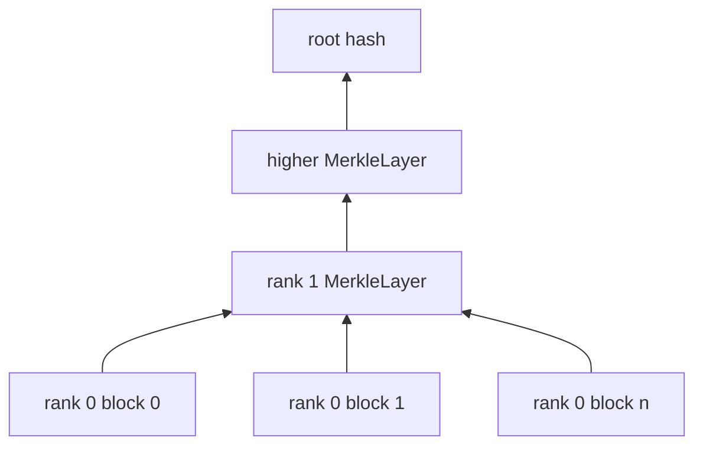
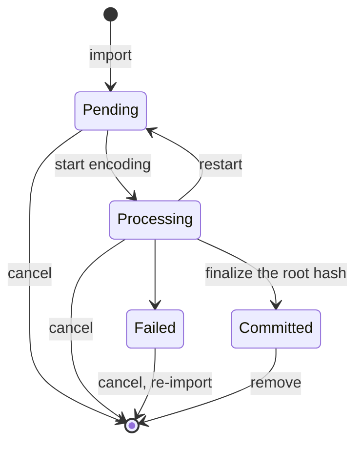
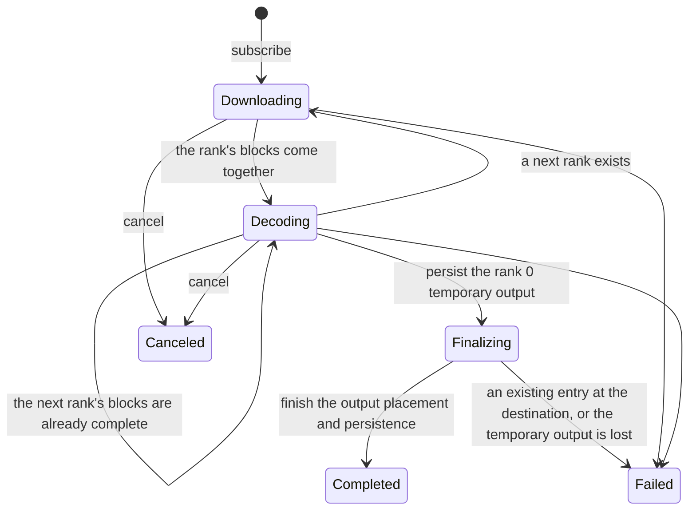
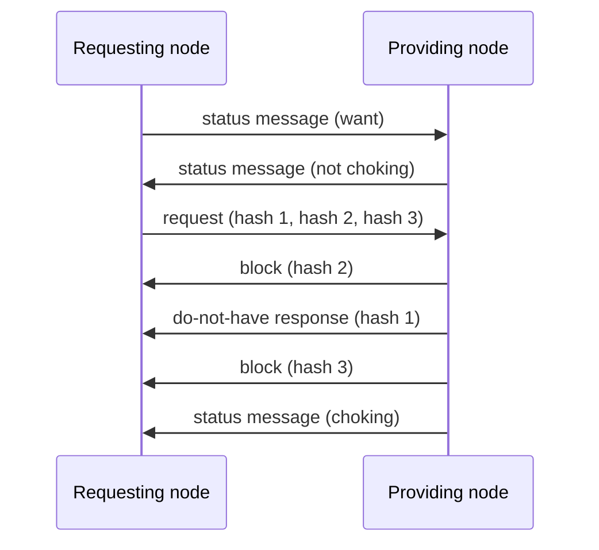

# Design of file publish and subscription

## 1. About this document

This document covers the design of converting a file into blocks and Merkle layers and publishing it, exchanging blocks between nodes, and verifying and decoding on the subscribing side.
Term definitions are the source of [terms.md](../terms.md#2-terminology).

### 1.1 Division of responsibilities among documents

| Document or source of truth | Owns |
| --- | --- |
| [design.md](../design.md#11-division-of-responsibilities-among-documents) | Overall structure, boundaries with other concerns, cross-cutting dependencies |
| This document | File publish, subscription, Merkle structure, state transitions, output reservation, integrity guarded by the Store, the block exchange protocol, block verification |
| [session.md](./session.md#2-responsibilities-and-boundaries) | Session establishment, per-use frame limits |
| [node-finder.md](./node-finder.md#2-responsibilities-and-boundaries) | Looking up nodes for an AssetKey |
| [storage.md](./storage.md#2-responsibilities-and-boundaries) | Persistence of metadata, blocks, and output files, finalization and reclamation procedures, recovery after failure |
| [core/negotiator/file](../../daemon/modules/engine/src/core/negotiator/file) | File publish, subscription, and transfer implementation |

### 1.2 Tenses used in this document

The body describes the completed design.
The implementation status and remaining work are consolidated in §7.
To check what works currently, read §7 first.

## 2. Responsibilities and boundaries

[FilePublisher](../../daemon/modules/engine/src/core/negotiator/file/file_publisher.rs) converts a local file into blocks and Merkle layers and finalizes a publishable root hash.
[FileSubscriber](../../daemon/modules/engine/src/core/negotiator/file/file_subscriber.rs) manages the blocks needed from a root hash and decodes the layers that have come together from the top down.
[FileExchanger](../../daemon/modules/engine/src/core/negotiator/file/file_exchanger.rs) establishes a Session with a peer using NodeFinder's lookup results and carries the publisher's and subscriber's blocks.

Separating encoding, transfer, and decoding makes the processing of local storage independent of the network Session lifetime.
The publisher and subscriber do not share state between publish and subscription.

Both the publisher side and the subscriber side split into the same three layers.

```text
FilePublisher / FileSubscriber      API entrypoint. Assembles the Store and the Task, starts and stops the Task
  |
  |--> TaskEncoder / TaskDecoder    Loop advancing encoding and decoding, pre-finalization cancellation,
  |      |                           and retries of placement and reclamation
  v      v
FilePublisherStore / FileSubscriberStore
                                    Manages the integrity and persistence of metadata, blocks, and output files
```

Only the Store rewrites metadata and block bodies and creates, places, and deletes output files.
TaskDecoder writes the decode result into a temporary output handle handed over by the Store and does not open the destination directly.
FilePublisher, FileSubscriber, and the Task change state only through the operations the Store exposes.
This layout keeps the integrity rules across the two storages (§4.3) and the locks closed inside the Store, so locks are not passed between types.
Blocks and temporary outputs whose deletion failed are reclaimed by the Store's sweep, reconciled against the metadata.
The Task makes the Store retry the sweep and the Finalizing placement with intervals until they succeed.
At shutdown, in-progress processing is cancelled and finalizing processing is waited on. If an I/O failure prevents finishing, it is carried over to the next startup as Finalizing.

## 3. Merkle structure

The file body is split into fixed-length blocks at rank 0, and the hash list of each rank's blocks is recursively block-ized as a higher MerkleLayer.



Because the hashes of lower blocks are obtained step by step from the root hash, a receiver does not need the whole file's hash list in advance.
Each received block is checked against the expected hash before being stored or used for decoding.

A MerkleLayer's rank represents the rank of the child blocks it enumerates.
The subscribing side starts from only the root hash, so the root block's rank is unknown until the root's layer is decoded.
The subscribing side does not check the root layer's rank and uses the next rank; for later layers it checks that the rank is one less than the parent's rank.

## 4. State transitions

The external API does not expose the internal state names directly and converts them into a stable contract following the long-running operation representation of [daemon-api.md](./daemon-api.md#5-design-decisions).

### 4.1 Publisher side

The publisher side splits the period before and after the root hash finalization into uncommitted files and committed files.



Pending, Processing, and Failed are the states of an uncommitted file, and only Committed can be advertised to the network.
Until the root hash is finalized, a temporary ID is used; after finalization the file is committed to the content identifier, so a process that failed midway is distinguished from a file that can be advertised.

An uncommitted file's row disappears on commit and cancel, and only Failed remains to show the reason for the failure.
When a committed file with the same root hash and file name already exists, a new committed file is not created and the uncommitted file row disappears.
Only one uncommitted file per path and file name can exist.
Importing a pair with a Pending or Processing file is rejected with `AlreadyExists`.
Importing a pair with a Failed file deletes that row and creates a Pending row with a new temporary ID.

A Task that finished encoding without committing ends with cancel, shutdown, failure, or a conditional update mismatch (§4.3); in all cases it makes the Store delete that temporary ID's blocks.
Blocks whose deletion failed are reclaimed by the sweep as blocks of a temporary ID with no Pending or Processing row (see [storage.md §4.3](./storage.md#43-publishing-commit-and-reclamation)).
Because the temporary ID is renewed per attempt, a late-running reclamation never deletes a new attempt's blocks, and a file can be re-imported without waiting for reclamation.

remove targets a committed file and stops the publication.
If the same root hash is published under another file name, the block rows and bodies remain until the last committed file disappears.

### 4.2 Subscriber side

The subscriber side alternates fetching blocks and decoding layers.



The hash set of the next rank obtained during decoding becomes the fetch target of the next Downloading.
cancel turns Downloading and Decoding into Canceled, keeping the rows and the blocks.
remove deletes the rows of subscriptions other than Finalizing, and when no subscription references the root hash anymore, also deletes the block rows and bodies.
cancel and remove of Finalizing are rejected. cancel of Completed, Failed, and Canceled does not change state.

Multiple subscriptions may reference the same root hash, and the block rows and bodies are shared per root hash.
Saving a block updates the progress of all Downloading subscriptions that reference that root hash.
If the next rank's blocks are already complete through another subscription, the next layer is decoded without waiting for reception.

The root hashes FileExchanger looks up peers for are limited to those of Downloading subscriptions.
The range of subscriptions that provide blocks is handled by §5.1.
Rank 0 is decoded into each subscription's temporary output.
The temporary output is created in the same directory as the destination with a conventional name including the subscription ID. The daemon creates and deletes only files with this name.
A completed output file is treated as the user's file and is not deleted by remove.

#### Output reservation and finalization

subscribe fails when an existing entry, such as a file, directory, or symlink, exists at the destination and does not overwrite it.
A name of the form `.<entry name>.axus-<subscription ID>.part` is the reserved name the daemon owns for temporary outputs and cannot be registered as a user file's final destination.
The reserved name is judged by the name string alone at registration, without distinguishing ASCII letter case, and rejected with an error distinguishable from existing entries.
This is because registering subscription A's temporary output name as subscription B's final destination would make A, when it recreates its temporary output after B finishes, delete B's completed output.
The rules for generating and judging the reserved name follow [storage.md §4.5](./storage.md#45-output-finalization-and-recovery).
A subscription already using the same destination in Downloading, Decoding, or Finalizing is also rejected at start.
Subscribing to the same root hash at a different destination is allowed.
Rejections at start other than the reserved name are early detection, and alternative representations differing only in letter case or Unicode normalization are not judged.
A collision between alternative representations and an entry an external process created after the start are detected by the non-overwriting placement failing at finalization, turning the subscription Failed.

Finishing the write into the temporary output is not yet Completed.
The point where the Store persists the temporary output and records Finalizing in the DB is the start of finalization.
Afterwards, the output is placed with a rename that does not replace an existing entry, the placement is persisted, and then Completed is recorded.
After finalization starts, cancellation is not allowed through; the subscription advances to Completed, Failed, or Finalizing awaiting retry.

At restart, whether placement happened is judged from the presence of the temporary output and the destination.
The judgment rules, and the handling that keeps Finalizing and retries when the destination directory is unreachable, follow [storage.md §4.5](./storage.md#45-output-finalization-and-recovery).
In no case is an existing file at the destination overwritten or deleted.

### 4.3 Integrity guarded by the Store

The state transitions advanced by the Task are written in one update whose condition includes the expected state before the transition.
If no matching row exists, nothing is written, following the earlier state change.
A failure record is also written with the same condition, so a cancelled subscription or publication is not overwritten with Failed.
Registering a block row does not overwrite an existing row and does not roll back the progress of other subscriptions sharing the same root hash.

For block operations that cannot be guarded by a state condition alone, the following locks are used.

| Store | What interruption causes | Lock |
| --- | --- | --- |
| FilePublisherStore | If remove deletes the last reference after a commit is judged done, a committed file with no blocks results. If a commit runs while remove or the sweep is deleting bodies, a newly committed body gets deleted | mutex. Serializes commit, remove, and the sweep from the reference checks through the body operations and metadata updates. The recovery inside open also runs in the same mutex. Encoding itself runs outside the lock |
| FileSubscriberStore | If a subscribe and a block save come in after remove or the sweep checks the last reference but before the block bodies are deleted, the bodies of blocks recorded as downloaded disappear | read-write lock. subscribe and block saves take read, remove and the sweep take write. Block receptions stay concurrent and only pause between remove and the sweep |

The subscription destination is guarded by a DB unique constraint over in-progress subscription rows.
The conditional update from Decoding to Finalizing is paired with the conditional update to Canceled that cancel/remove performs first.
If Finalizing is recorded first, cancel/remove is rejected; if Canceled is recorded first, output placement does not start. The temporary output is deleted only after this update is finalized.
When the result of the Finalizing DB commit is unknown, placement and temporary output deletion wait until the row is re-read and the state confirmed.
The shared-block lock is not held throughout decoding and the file's synchronous writes.
Because the temporary output name includes the subscription ID, a late-finishing Task or sweep never deletes another subscription's temporary output or output file.

The order of rewrites across the two storages and the recovery of a state that ended midway are handled by [storage.md](./storage.md#4-logical-keys-and-migration).

## 5. Block exchange

FileExchanger connects nodes that exchange blocks of the same root hash with a Session.
On the protocol, the publisher side and the subscriber side are indistinguishable: any node can request blocks and provides the blocks it holds.
FileExchanger's messages are defined as one RocketPack enum, and the field structure is the source of [file.rpf](../../daemon/rpfs/file.rpf).

### 5.1 Participating nodes and advertisement

Blocks are provided by a publisher side holding committed files and a subscriber side holding a subscription in Downloading, Decoding, Finalizing, or Completed.
The blocks of a root hash referenced only by Canceled and Failed subscriptions are not provided even if they remain in the Store.

FileExchanger advertises its provided root hashes to NodeFinder by push and requests the same root hashes with want.
NodeFinder returns the location to a node that sent a want, so even a node with all blocks must send a want to obtain the locations of nodes in the middle of fetching.
A subscription is an advertisement target from before saving blocks.
Therefore, the nodes in a file's location info do not necessarily hold all blocks and may not hold any block.

Both the publisher side and the subscriber side connect to the locations of their own root hashes.
Because the locations the publisher gets include subscriber sides in the middle of fetching, a publisher behind a NAT that cannot accept can still connect out and hand over blocks.

### 5.2 Session establishment and connection slots

One Session is assigned to one root hash and is unique per pair of node ID and root hash.
After the Session layer's use selection, the two sides exchange supported versions, the dialing side conveys the root hash, and the accepting side returns accept or reject.
This exchange also applies the §5.3 receive deadline.
The accepting side rejects when it does not provide that root hash, when the Session count for that root hash is at the limit, or when the peer is excluded (§5.7).
When both sides dial the same node/root-hash pair, the Session established by the smaller node ID is kept, following [the same rule as NodeFinder](./node-finder.md#keep-the-session-established-by-the-smaller-node-id-when-duplicates-occur).

Connection slots are limited in two stages.
An overall limit is placed on each of fetch dialing, serve dialing, and acceptance, and a further limit on the Sessions one root hash can use.
Fetch dialing targets the root hashes of Downloading subscriptions; serve dialing targets the other provided root hashes.
When the fetch dialing slots are insufficient, they are allocated from the subscriptions with the higher priority.

### 5.3 State messages and Session lifetime

Each node tells, per Session, whether it wants the peer's blocks and whether it chokes the peer, in a status message.
Immediately after establishment, both sides are treated as choking the peer and as not wanting the peer's blocks.
A status message is sent when either value changes and every cycle.

The periodic send doubles as a liveness check.
A Session that receives no message for 3 times the cycle is closed.
A choked node cannot send requests even if it wants blocks, so requests and responses alone cannot distinguish a Session waiting for unchoke from a Session against an unresponsive peer.

A Session where both sides do not want the peer's blocks for a period is closed.
This prevents Sessions between nodes with all blocks from occupying connection slots.
A closed node/root-hash pair is removed from the dialing candidates for a period.
Because the location info still contains that node, without this the same peer would be redialed immediately after closing.
Incoming dials are still accepted during this period, since the peer may have newly started wanting blocks.

### 5.4 Requests and responses

A request can be sent only while the peer is not choking us.
A request is a list of hashes of wanted blocks, and the peer returns a block for each held hash and a do-not-have response for each missing one.
A block is carried one per frame with the content hash.



Because requests and responses are matched by hash, the response order does not have to follow the request order.

There is no procedure for announcing held blocks in advance; what the peer holds is learned from responses.
A node in the middle of fetching cannot distinguish a requested hash that does not belong to the file from one it has not fetched yet.
In both cases it returns a do-not-have response, and requesting a hash that does not belong to the file is not treated as a violation.

There are limits on the number of hashes in one request and on the number of requests awaiting responses on one Session.
If, while requests await responses, neither a block nor a do-not-have response arrives within the request deadline, the peer is treated as unresponsive and the Session is closed.
Measuring the deadline from the last response instead of per request keeps a Session receiving multiple blocks in sequence on a slow connection open.
Because a choke removes all awaiting responses at that point, the request deadline does not advance while choked.

A node that conveyed a choke discards unresponded requests received from that peer and ignores requests arriving while choked.
Because requests can cross a choke notification, these requests are not treated as violations.
A choked node retracts the requests awaiting responses on that Session and returns the target blocks to unassigned (§5.5).

The maximum block length is 1 MiB.
import rejects a block size over 1 MiB, and FileExchanger's frame limit is based on this value (see [session.md](./session.md#frame-limits-by-use)).

### 5.5 Request assignment

FileExchanger manages, per root hash, which block is requested from which Session in one place.
The per-Session workers only send and receive and do not judge which block to request.

Request targets are the un-fetched blocks of the current rank that the Store holds, shared between subscriptions referencing the same root hash.
One block is requested from only one Session at a time.
An assigned block is returned to unassigned on a do-not-have response, on a choke, when the Session closes, or when the content hash does not match, and is reassigned to another Session.
A peer that returned a do-not-have response is not asked for the same hash again for a period.

### 5.6 Selecting send targets by transfer volume

FileExchanger records, per node ID, the received bytes of blocks whose content hash matched and the sent bytes, in memory.
The records are summed across Sessions and root hashes, and the ranking uses only the received bytes of the recent period.
This prevents a node that provided many blocks in the past from staying prioritized after it stops providing.

Choke is judged per node, and the same state is conveyed across all Sessions with that node.
Every status message cycle, of the nodes that want our blocks, a fixed number in descending order of received bytes are unchoked and the rest are choked.
Among nodes with equal received bytes, the choice is random.
Therefore, a publisher side that has not fetched anything randomly unchokes the nodes that want blocks.

Separately, one node is unchoked at random from those wanting blocks and re-chosen at regular intervals.
Without this slot, a new node with no record cannot receive blocks and has no way to climb the unchoke ranking to obtain blocks to provide to others.

### 5.7 Verification and violations

A received block is checked in two stages.
FileExchanger confirms that the block's hash is in a request awaiting a response on that Session.
`FileSubscriber::write_block` computes the content hash and checks it against the hash carried on the block, storing only matching blocks.
`write_block` returns, distinguishing the three outcomes: stored, unneeded, and hash mismatch.
Because a tainted block is not persisted, the check happens before writing the metadata and block bodies.

The following acts are violations, and FileExchanger closes the Session and excludes that node ID for a period.

- Sending a block whose content hash does not match
- Sending a block that was not requested
- Exceeding the limit on the number of hashes in one request or the number of requests awaiting responses
- Sending a message over the frame limit

An excluded node is removed from the dialing candidates, and Sessions from that node are not accepted.
A request-deadline overrun cannot be distinguished from a flaky connection, so the exclusion is shorter than for a violation.
The exclusion is held in memory and disappears at restart.
Because a node ID can be changed by regenerating a key, the exclusion only curbs repetition under the same node ID; the trust evaluation of the peer is handled by [trust-security.md](./trust-security.md#3-division-of-guarantees-and-threats).

### 5.8 Constants and defaults

The following values must agree with the peer and are protocol constants.

| Item | Value |
| --- | --- |
| Maximum block length | 1 MiB |
| Number of hashes in one request | 64 or fewer |
| Requests awaiting responses on one Session | 16 or fewer |
| Status message cycle and receive deadline | 10 s, 30 s |
| Request deadline | 60 s |

The following values may vary per node, with the table values as the defaults.

| Item | Default |
| --- | --- |
| Nodes unchoked in order of received bytes | 4 |
| Randomly unchoked nodes and the re-choice interval | 1, 30 s |
| Period of received bytes used for ranking | 10 min |
| Time until a Session neither side wants is closed | 60 s |
| Time a mutually-unwanted closed pair stays out of the dialing candidates | 10 min |
| Time before a do-not-have responder is asked the same hash again | 30 s |
| Exclusion for violations and for request-deadline overruns | 30 min, 3 min |
| Sessions one root hash can use | 8 |

## 6. Design decisions

### 6.1 Decided

The separation of lookup and file transfer is the source of [design.md](../design.md#51-decided).

#### MerkleLayer.rank represents the children's rank

**Decision**
The rank of a MerkleLayer records the rank of the child blocks the layer enumerates, not the rank of the block the layer is stored in.

**Rationale**
The subscribing side gets the rank of the next blocks to fetch directly when it decodes the layer.
There is no existing wire data to keep compatible with, and this meaning is fixed by a round-trip test from encode to decode.

**Rejected**
Recording the rank of the storing block was the meaning the encoder took before the fix.
The subscribing side would need to subtract 1 from the storing rank to compute the next rank on every layer decode, so it is not taken.

#### Consolidate the rewrites of metadata and block bodies in the Store

**Decision**
The operations that rewrite the publisher-side and subscriber-side metadata and block bodies live only in the Store, and the locks are held inside the Store.
Output creation, finalization, deletion, and the sweep are also the Store's.
The loops for encoding/decoding, pre-finalization cancellation, and retrying the sweep and placement stay in the Task.

**Rationale**
With multiple mutating types, a lock guarding rewrites across the two storages would be passed between types, and any path that skips the lock becomes a race.
Consolidating the rewrites in one type lets the integrity rules and lock ranges be checked in one place.
Cancelling an in-progress operation belongs to the loop's lifetime, so the Task, not the Store, holds it.

**Rejected**
A design that puts the lock in the Task and delegates entry operations to it moves subscribe and block saves, on the subscriber side, into the Task, so the Task holds both the control of processing and the integrity of persistence.
A design that serializes all operations on the Task loop to remove locks stops block reception and remove while a large file is being encoded or decoded, so it is not taken.

#### Write Task state transitions with conditional updates on the expected state

**Decision**
The state transitions and failure records advanced by the Task are written as updates conditioned on the expected state, and when no row matches, nothing is written.

**Rationale**
cancel and remove are called in parallel with the Task's processing.
An upsert writing back the whole row would, after an interruption, restore the state with stale content and recreate a deleted row.
A conditional update performs the judgment and the write in one SQLite statement, leaving no room for interruption between the check and the write.

**Rejected**
Checking for cancellation immediately before the write cannot prevent an interruption between the check and the write and does not protect saves of blocks that are not cancellation targets.
Serializing with a per-file lock requires managing a lock table, and cancel waits for the end of a long decode.

#### Separate subscription cancel and remove

**Decision**
cancel turns a subscription that is fetching or decoding into Canceled, keeping the row and blocks.
remove deletes rows other than Finalizing and deletes blocks that have lost their references.
Both are rejected during finalization, and output files are not deletion targets.

**Rationale**
To keep a cancelled subscription as a record while still having a way to delete every row including Completed and Failed.
Limiting the block-deletion paths to the single remove lets the release conditions be checked in one place.

**Rejected**
Having cancel delete the rows leaves no record of the cancellation.
Releasing blocks as soon as no in-progress subscription remains requires writing the release into each of the cancel, completion, and failure paths.

#### Delete uncommitted files of the publisher side on commit and cancel

**Decision**
The rows of committed and cancelled uncommitted files are deleted, and only the Failed row remains.
The publisher-side remove targets committed files and refers only to the operation of stopping the publication.

**Rationale**
Because the committed file carries the publication record, there is nothing left on an uncommitted file after the commit.
An uncommitted file is unique per path and file name, so keeping the row would block re-importing the same file.
Failed rows remain to show the reason for the failure and are replaced by a new-temporary-ID row on re-import.

**Rejected**
Keeping a committed file as Completed requires a separate row deletion before re-import.
Having a separate remove for uncommitted files creates two kinds of deletion operations on the publisher side and is hard to distinguish from stopping a publication.

#### Allow duplicate subscriptions to the same root hash

**Decision**
Multiple subscriptions may reference the same root hash.
Block rows and bodies are shared per root hash.

**Rationale**
To keep the use of writing the same content to different paths.
Sharing blocks lets a later subscription use the blocks that came together earlier without receiving them.

**Rejected**
Rejecting a subscribe to a root hash with an in-progress subscription fixes the subscriptions a block save updates to one, but the same content cannot be written to multiple paths at the same time.

#### Delete block bodies in place on remove

**Decision**
remove deletes the last reference from the metadata and then, in the same lock, deletes the block bodies.
When body deletion fails, the sweep reclaims the blocks as unreferenced.

**Rationale**
To release the capacity of a deleted subscription or publication without waiting for a restart.

**Rejected**
A design where remove deletes only metadata and reclaims block bodies only at startup recovery removes the need for the §4.3 lock, but the capacity is not released until the next startup.

#### Do not overwrite outputs, and do not cancel during finalization

**Decision**
Existing outputs and another in-progress subscription to the same destination are rejected, and Finalizing is recorded after the temporary output's decode finishes.
cancel/remove are rejected until the non-overwriting placement, the placement persistence, and the Completed record finish.

**Rationale**
To protect a user's existing files and completed outputs while recovering a subscription that ended between the filesystem and DB finalization.
Not deleting the row during finalization lets the temporary output name and destination be derived from the row after a restart.

**Rejected**
Decoding directly into the destination cannot distinguish and protect existing files from partial outputs on interruption.
Making remove wait during finalization makes the response time depend on the file and DB synchronous writes, so it is not taken.

#### Use a new temporary ID for re-import

**Decision**
Re-importing a Failed file replaces the Failed row with a row of a new temporary ID.
The blocks of the failed attempt are left to the sweep without waiting for reclamation.

**Rationale**
Because the temporary ID of a reclamation target never overlaps a new attempt's, a late-running reclamation never deletes a new encoding's blocks.
No reclamation record or re-import rejection is needed.

**Rejected**
Reusing the Failed row and temporary ID by returning it to Pending makes the reclamation of the old attempt's blocks race the new attempt, requiring a mechanism to reject re-import until reclamation finishes.

#### Subscriptions in the middle of fetching also provide blocks

**Decision**
In addition to the publisher side, a node with a subscription in any of Downloading, Decoding, Finalizing, and Completed provides blocks.
The blocks of a root hash referenced only by Canceled and Failed subscriptions are not provided.

**Rationale**
The more nodes that fetch, the more providers exist, and a file whose publisher stopped can keep being fetched as long as a node holding blocks remains.
Because the subscriber-side Store keeps blocks until remove, no extra storage is needed for providing.
The cost is that the peer cannot be assumed to hold all blocks, and do-not-have responses and re-request rules are needed (§5.4, §5.5).
cancel is the operation of the user stopping the fetch, so it also stops providing and advertising.
The way to stop providing for a completed subscription is remove.

**Rejected**
A design where only the publisher side provides is the simplest, but the providers are limited to the importing node.
Adding only completed subscriptions always has providers holding all blocks, so no hold-state procedure is needed, but blocks cannot be passed between nodes fetching at the same time.
Providing as long as a row exists, including Canceled and Failed, keeps sending and advertising after cancel and makes remove the only way to stop.
Stopping the provision at Completed reduces all-block providers exactly when they are completed.

#### Subscriptions are advertised as locations from the start

**Decision**
The subscriptions that provide blocks (§5.1) advertise the root hash by push from the start, before saving any block.
Both the publisher side and the subscriber side request their own root hashes by want and connect to the obtained locations.
NodeFinder's want does not carry the requester's NodeProfile.

**Rationale**
A publisher side behind a NAT that cannot accept must connect on its own to hand over blocks.
If a fetching node advertises itself as a location, the publisher side only needs to request its own root hash with want to find the fetching node, without changing NodeFinder's wire or storage format.
With an advertise-after-saving scheme, the first node to fetch a file that only such a publisher side serves cannot be found by the publisher side and cannot connect on its own.
The costs are that location info includes nodes holding no blocks, and that the reachable addresses of subscribing nodes are known to the nodes relaying the location info.
Because a node with all blocks also sends wants, the want count grows with the number of provided root hashes.

**Rejected**
Carrying the requester's NodeProfile in want and having NodeFinder return the requesting node keeps locations and requests distinguished while letting the publisher side connect, but changes NodeFinder's wire and storage format and grows the want message.
A design where the publisher side only accepts and never dials changes neither NodeFinder nor the advertisement meaning, but a file served only by a publisher side behind a NAT without UPnP cannot be fetched.

#### Assign one Session to one root hash

**Decision**
FileExchanger's Session handles only one root hash and is unique per node ID and root hash pair.
When a node pair exchanges multiple files, a Session is established per file.

**Rationale**
The requests awaiting responses and the want state close within one file, and the message does not need a root hash.
The per-root-hash Session count limit and the rule for closing Sessions that are no longer wanted can be counted directly as Session counts.
The cost is one Session and secure-channel handshake per file for the same node pair.

**Rejected**
Handling multiple root hashes in one Session per node pair keeps the handshake and connection slots at one per node pair, but requires each message to carry the root hash and a procedure for conveying which root hashes both sides handle inside the Session.

#### Convey held blocks in responses to requests

**Decision**
Held blocks are not announced in advance; each requested hash gets a block or a do-not-have response.

**Rationale**
No per-peer hold state is needed, and the correspondence between a requested hash and the received block can be used as the check as-is.
Because a subscriber does not know the hashes of lower blocks until the higher rank is decoded, hash-specified requests match how fetching progresses.
The cost is more do-not-have responses to peers at a similar fetch stage.

**Rejected**
A design where both sides convey the current rank and a bitmap of that rank's indexes can request only the blocks the peer holds and can first fetch blocks held by few nodes, but requires managing per-Session bitmaps and diff messages.
First querying by hash whether a block is held adds one round trip.

#### Send blocks one per frame in immediate request-response

**Decision**
A request is sent at the moment a block is needed, and the peer returns one held block per frame.
The flow is controlled by the limit on requests awaiting responses on one Session.

**Rationale**
The transfer speed is not limited by a send cycle, and the frame limit can be lowered to the maximum block length.

**Rejected**
Like NodeFinder, batching requests and blocks into one message per cycle lets the receive deadline be derived from the cycle, but the transfer speed is determined by the cycle and the blocks per message, and the frames grow.

#### Set the maximum block length to 1 MiB

**Decision**
import rejects a block size over 1 MiB.
FileExchanger's frame limit is 1 MiB plus the hash and tag carried in the block message.

**Rationale**
A block is the unit a receiver loads into memory for one frame and computes the hash of, and the unit of transfer discarded when the hash does not match.
The smaller the limit, the smaller the per-Session receive buffer and the transfer lost to one bad block, and the more finely requests can be split across peers.
The cost is more blocks and metadata rows; a 1 TiB file has about a million rank 0 blocks.

**Rejected**
A 4 MiB limit reduces the number of blocks and request round trips, but quadruples the receive buffer and the loss per bad block.
Keeping the 64 MiB frame limit and aligning only the block-size limit allows a 64 MiB receive buffer per Session of an authenticated peer.

#### Check the content hash at the Store entry

**Decision**
`FileSubscriber::write_block` checks the content hash before saving and returns, distinguishing stored, unneeded, and hash mismatch.
FileExchanger closes the Session on a mismatch.
Whether a received block was requested is checked by FileExchanger.

**Rationale**
No matter how many paths save a block, a save that bypasses the check cannot arise.
The rule "content hash verification happens before the write" can be confirmed at the Store entry in one place.

**Rejected**
A design where FileExchanger checks right after reception and hands only matching blocks to `write_block` keeps the return value unchanged, but every new path calling `write_block` must add the check, leaving entries that can save unverified blocks.

#### Decide request assignment in one place per root hash

**Decision**
FileExchanger manages block assignment per root hash in one place and requests one block from only one Session at a time.

**Rationale**
Because one root hash has as many Sessions as peers, choosing blocks per Session would receive the same block, up to 1 MiB each, in duplicate from multiple peers.
Consolidating the decision and leaving send/receive to per-Session workers is the same split as [NodeFinder](./node-finder.md#4-separation-of-decision-and-communication).

**Rejected**
Per-Session workers randomly choosing from un-fetched blocks share no state, but the duplicate reception grows as peers grow and is especially large in the late stage when few blocks remain.

#### Limit connection slots in two stages, overall and per root hash

**Decision**
An overall limit is placed on each of fetch dialing, serve dialing, and acceptance, and a limit on the Sessions one root hash can use.
When the fetch dialing slots are insufficient, they are allocated from higher-priority subscriptions.

**Rationale**
Because Sessions are established per node/root-hash pair, an overall limit alone lets one file consume all slots and stall other files' fetches.
A per-root-hash limit alone makes the total Session count grow with the number of published and subscribed files.

**Rejected**
Holding only an overall limit and randomly choosing the root hash to connect cannot control bias between files and does not reflect priority.

#### Exclude violating nodes for a period

**Decision**
The node IDs that committed the §5.7 violations are recorded in memory, removed from the dialing candidates for a period, and Sessions from those nodes are not accepted.

**Rationale**
Closing the Session alone lets the same node reconnect immediately and keep sending bad blocks.
Holding the exclusion in memory avoids a release mechanism and a storage format.

**Rejected**
Only closing the Session adds no state but accepts the peer's reconnection as-is, letting a bad-block node keep consuming accept slots.
Persisting excluded node IDs to the DB to keep the exclusion across restarts requires a release mechanism and storage format and overlaps the role of the Web of Trust's trust evaluation ([trust-security.md](./trust-security.md#unit-and-propagation-of-web-of-trust)).

#### Record transfer volume per node ID and narrow send targets with choke

**Decision**
FileExchanger records received and sent bytes per node ID in memory and unchokes the nodes with more received bytes first.
Requests from choked nodes are not served.

**Rationale**
Because a node in the middle of fetching also provides, every participating node uses the send bandwidth.
Prioritizing block providers makes fetch-only non-providing nodes receive fewer blocks.
Conveying a choke lets the peer skip sending unserved requests and assign those blocks to other Sessions.
Recording per node ID is because Sessions split per root hash and close when no longer wanted.
A relationship where A hands file X to B and B hands file Y to A looks like one-way transfer in per-Session records, and the record disappears every time a Session closes.

**Rejected**
Serving requests unconditionally is the smallest implementation, but does not distinguish non-providing nodes.
A design that gathers all Sessions' unserved requests into one queue, limits the blocks sent at once, and sends in order of received bytes needs no state notification, but must answer each deferred request with "cannot send now", and the requester does not know whether it will be served until it tries.
Varying the per-Session awaiting-response limit with the received bytes leaves little difference between nodes, and the total send volume grows with the number of peers.
Persisting the record to the DB to carry it across restarts requires a storage format, count limits, and reclamation rules, and overlaps the Web of Trust.

#### Judge liveness from periodic status message sends

**Decision**
Each node combines whether it wants blocks and whether it chokes the peer into one status message and sends it on the value changing and every cycle.
A Session receiving no message for 3 times the cycle is closed.

**Rationale**
A choked node cannot send requests, so communication stops.
Judging unnecessary Sessions only by whether traffic flows would close a Session waiting for unchoke.
With a send-every-cycle promise, the receive deadline can be derived from the cycle as with NodeFinder.
Conveying want limits the unchoke candidates to the nodes that want blocks.

**Rejected**
Sending status only when the value changes and letting the requester close a Session that stays choked past a period sends fewer messages, but closes a Session against a peer that would unchoke if waited on, and cannot distinguish an unresponsive peer from one merely making it wait.

### 6.2 Deferred

#### Send bandwidth limit

**Current state**
FileExchanger limits sending by the number of unchoked nodes and the per-Session awaiting-response request count.
There is no limit on the send speed itself.

The candidates are the following two.

1. A limit on FileExchanger's overall send speed lets the user curb line occupation, but requires rules so a delayed response does not exceed the peer's request deadline.
2. Limiting nothing and adjusting only the number of unchoked nodes adds no mechanism, but the ratio to the line speed cannot be specified.

**Why not decided yet**
Because there is no REST API that receives transfer settings, and the actual send volume on a real line is not measured.

**Decision condition**
Decide when adding transfer settings to the publish and subscribe REST API, or when a multi-node integration test confirms the sends occupy the line.

## 7. Current status and remaining work

FilePublisher ingests a file, block-izes it, generates MerkleLayers, finalizes the root hash, commits, and reads out committed blocks.
FileSubscriber starts a subscription, saves blocks, and decodes per rank, confirmed from publishing to decoding by engine-internal round-trip tests.
`FileSubscriber::write_block` does not check the received block's hash and does not return the save result to the caller.

The publisher and subscriber sides are split into the §2 three layers, and the metadata and block-body rewrites are consolidated in the Store.
Task state transitions and failure records are updated with a condition on the expected state, and the Store-internal locks control races between commit, remove, subscribe, and block saves.
The Task cancels in-progress processing with a child CancellationToken, and shutdown waits for the workers.

The entry points have cancel and remove.
The publisher side deletes uncommitted files on commit and cancel.
Importing to the same path and file name of a Failed file deletes the old row and creates a Pending row of a new temporary ID in one SQLite transaction.
Even if the reclamation of the old attempt's blocks is delayed, the new attempt's blocks are not deleted.
The subscriber side allows subscriptions to the same root hash and reflects shared-block progress into all Downloading subscriptions.
When the fetched blocks are complete, the next layer is decoded without waiting for reception, and only Downloading root hashes are returned as the peers to look up.
A completed output file survives remove.

The §4.2 output reservation and the registration-time rejection of existing entries, including files, directories, and symlinks, are implemented.
Rank 0 is decoded only into the temporary output the Store created, and the file sync, Finalizing record, non-replacing placement, placement sync, and Completed record run in order.
Finalizing recovery and the rejection of cancel/remove during finalization are implemented.
The publisher side runs the §2 runtime sweep, and TaskEncoder retries a failed reclamation with increasing intervals.
The subscriber side also reclaims unreferenced-root blocks and the temporary outputs of Canceled and Failed with the sweep.
TaskDecoder retries Finalizing placement and sweep failures with increasing intervals.
The remaining persistence work is consolidated in [storage.md §6](./storage.md#6-current-status-and-remaining-work).

The §5 block exchange is not implemented.
FileExchanger has only the connection and accept tasks; there is no message definition, send/receive loop, request assignment, choke judgment, or node exclusion.
There is also no registration of advertisements and requests with NodeFinder, and no wiring into AxusService.
The connection task distinguishes Sessions only by node ID, and the connection slots are an overall limit on publish dialing, subscribe dialing, and acceptance.
The subscriber side has no entry for handing FileExchanger the stored blocks, the un-fetched blocks of the current rank, and the provided root hashes.
import checks only that the block size is not 0, and FileExchanger's frame limit is 64 MiB.
The block exchange implementation is the first item of [design.md](../design.md#62-roadmap).
There is no REST API to start publishing and subscribing.

For confirmed bugs, see [issues.md](../issues.md).
