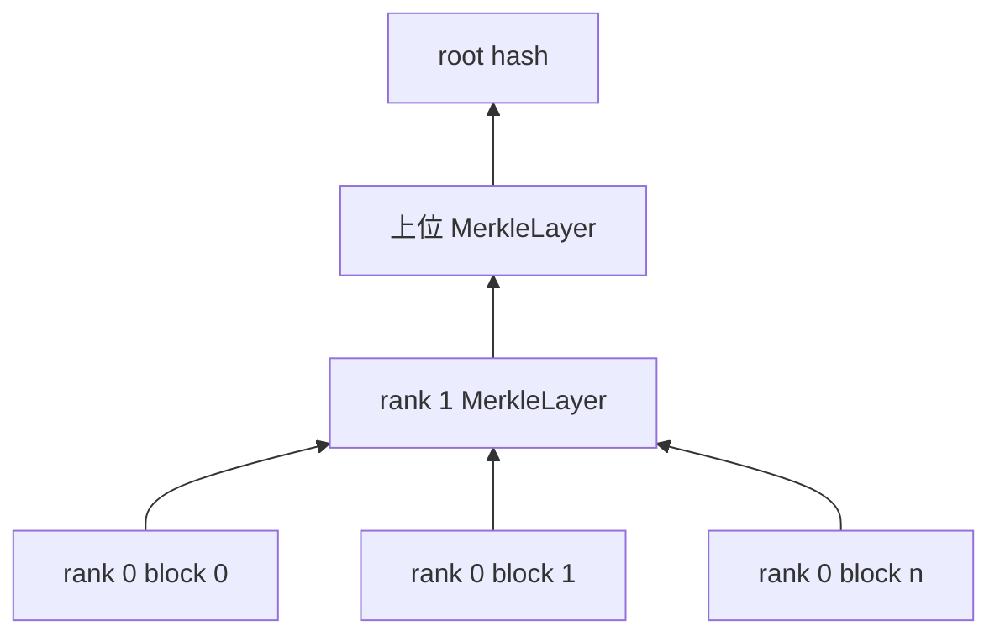
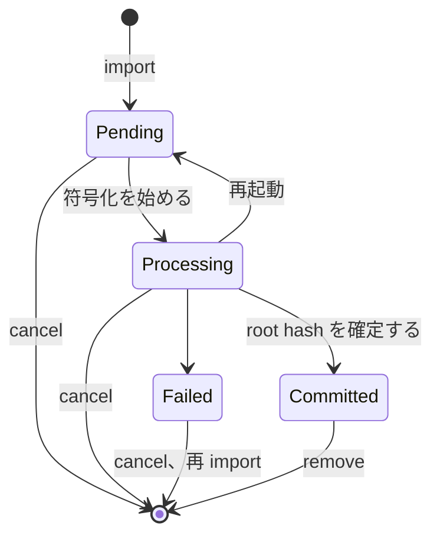
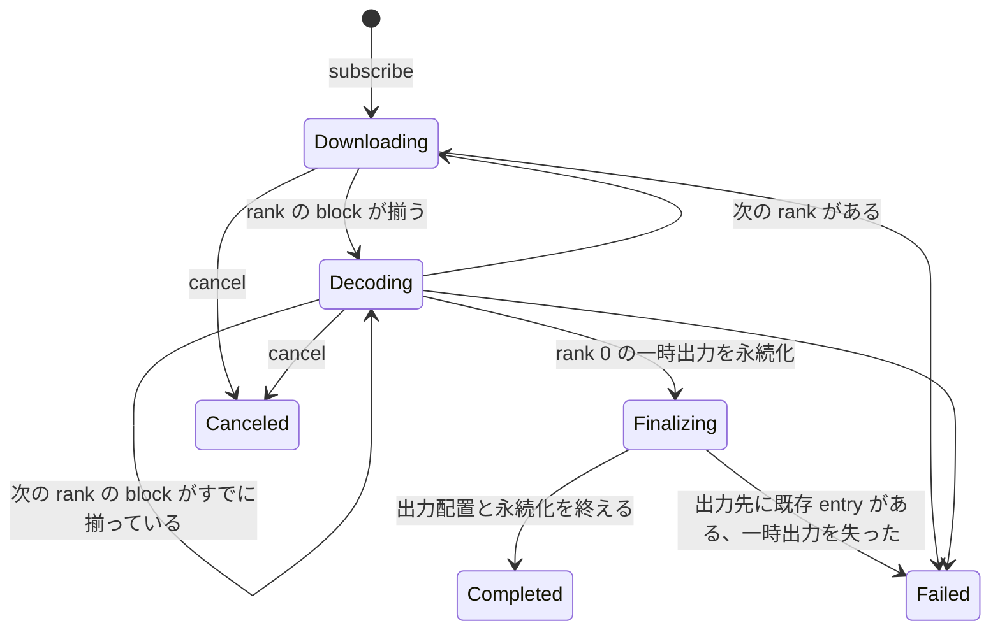
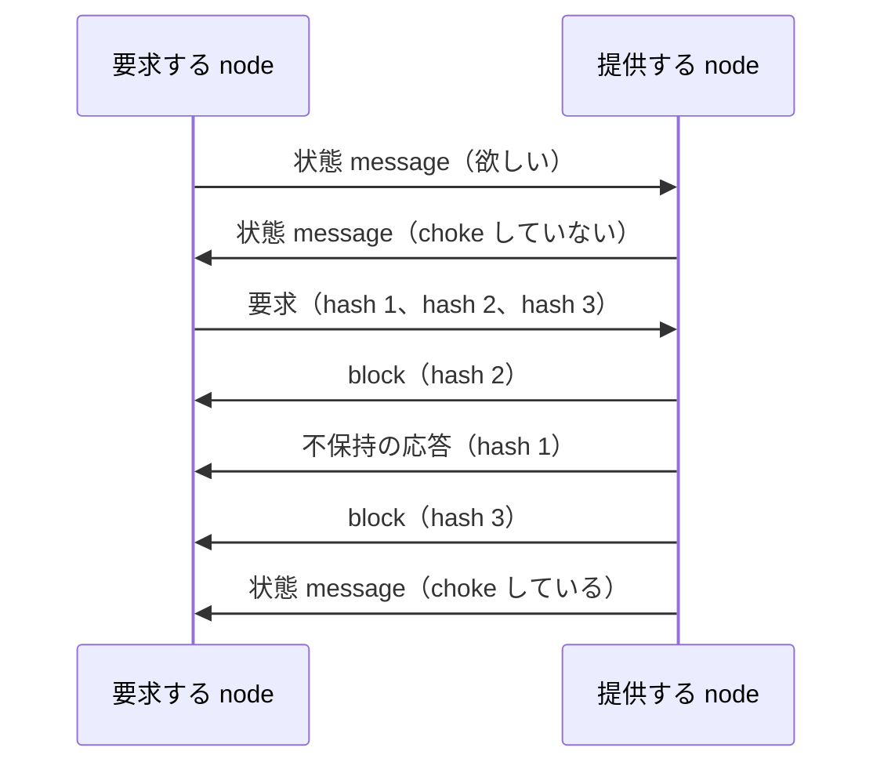

# file の公開と購読の設計

## 1. このドキュメントについて

本書は file を block と Merkle layer へ変換して公開し、node 間で block を交換し、購読側で検証および復号する設計を扱う。
語の定義は [terms.md](../terms.md#2-用語一覧) が正とする。

### 1.1 文書間の責務分担

| 文書または正本 | 受け持つもの |
| --- | --- |
| [design.md](../design.md#11-文書間の責務分担) | 全体構成、他の関心事との境界、横断的な依存関係 |
| 本書 | file の公開、購読、Merkle 構造、状態遷移、出力先の予約、Store が守る整合性、block 交換 protocol、block の検証 |
| [session.md](./session.md#2-責務と境界) | Session の確立、用途ごとの frame 上限 |
| [node-finder.md](./node-finder.md#2-責務と境界) | AssetKey に対応する node の探索 |
| [storage.md](./storage.md#2-責務と境界) | metadata、block、出力 file の永続化、確定と回収の手順、障害後の回復 |
| [core/negotiator/file](../../daemon/modules/engine/src/core/negotiator/file) | file 公開、購読、転送の実装 |

### 1.2 本書の時制について

本文は完成形の設計を記述する。
実装状況と残作業は §7 に集約する。
現在動く範囲を確認する場合は §7 を先に読む。

## 2. 責務と境界

[FilePublisher](../../daemon/modules/engine/src/core/negotiator/file/file_publisher.rs) は local file を block と Merkle layer に変換し、公開可能な root hash を確定する。
[FileSubscriber](../../daemon/modules/engine/src/core/negotiator/file/file_subscriber.rs) は root hash から必要な block を管理し、揃った layer を上位から順に復号する。
[FileExchanger](../../daemon/modules/engine/src/core/negotiator/file/file_exchanger.rs) は NodeFinder の探索結果を使って相手と Session を張り、publisher と subscriber の block を運ぶ。

符号化、転送、復号を分けることで、local storage の処理を network Session の寿命から独立させる。
publisher と subscriber は公開用と購読用の状態を共有しない。

公開側と購読側は、どちらも同じ 3 層に分かれる。

```text
FilePublisher / FileSubscriber      API の入口。Store と Task を組み立て、Task を起動して停止する
  │
  ├──▶ TaskEncoder / TaskDecoder    符号化と復号、確定前の取り消し、配置と回収の再試行を進める loop
  │      │
  ▼      ▼
FilePublisherStore / FileSubscriberStore
                                    metadata、block、出力 file の整合性と永続化を管理する
```

metadata と block 実体を書き換え、出力 file を作成・配置・削除するのは Store だけである。
TaskDecoder は Store から渡された一時出力の handle へ復号結果を書き、出力先を直接開かない。
FilePublisher、FileSubscriber、Task は Store が公開する操作を通して状態を変える。
この配置により、2 つの storage にまたがる整合性の規則（§4.3）と lock が Store の中で閉じ、lock を型の間で受け渡さずに済む。
削除に失敗した block と一時出力は、Store の sweep が metadata と照合して回収する。
Task は、sweep と Finalizing の配置が成功するまで、間隔を置いて Store に再試行させる。
停止時は確定前の処理を取り消し、確定中の処理は完了を待つ。I/O 障害で終えられなければ Finalizing のまま次回起動へ引き継ぐ。

## 3. Merkle 構造

file 本体を rank 0 の固定長 block に分け、各 block の hash 列を上位の MerkleLayer として再帰的に block 化する。



root hash から下位 block の hash を段階的に得られるため、受信者は file 全体の hash 一覧を事前に持つ必要がない。
各受信 block は期待する hash と照合してから保存または復号に使う。

MerkleLayer の rank は、その layer が列挙する子 block の rank を表す。
購読側は root hash だけから始めるため、root block の rank は root の layer を復号するまで分からない。
購読側は root の layer の rank を照合せずに次の rank とし、以降の layer では親の rank より 1 小さいことを照合する。

## 4. 状態遷移

外部 API は内部状態名をそのまま公開せず、[daemon-api.md](./daemon-api.md#5-設計判断) の長時間操作の表現に従って安定した contract へ変換する。

### 4.1 公開側

公開側は root hash の確定前後を uncommitted file と committed file に分ける。



Pending、Processing、Failed は uncommitted file の状態であり、Committed だけが network へ広告できる。
root hash が確定するまでは一時 ID を使い、確定後に内容識別子へ commit するため、途中で失敗した処理と広告できる file を区別できる。

uncommitted file の行は commit と cancel で消え、失敗の理由を見せるために Failed だけが残る。
同じ root hash と file 名の committed file がすでにあるときも、新しい committed file を作らずに uncommitted file の行を消す。
同じ path と file 名の uncommitted file は 1 つしか持てない。
Pending か Processing の file がある組の import は `AlreadyExists` で拒否する。
Failed の file がある組の import は、その行を消し、新しい一時 ID で Pending の行を作る。

commit せずに符号化を終えた Task は、cancel、停止、失敗、条件付き更新の不一致（§4.3）のどれで終えた場合も、その一時 ID の block を Store に消させる。
削除に失敗した block は、Pending と Processing の行がない一時 ID の block として sweep が回収する（[storage.md §4.3](./storage.md#43-公開の-commit-と回収)）。
一時 ID を試行ごとに新しくするため、遅れて走る回収が新しい試行の block を消すことはなく、回収の完了を待たずに再 import できる。

remove は committed file を対象にし、公開をやめる。
同じ root hash を別の file 名で公開していれば、block の行と実体は最後の committed file が消えるまで残る。

### 4.2 購読側

購読側は block の取得と layer の復号を交互に進める。



復号中に得た次の rank の hash 群が、次の Downloading の取得対象になる。
cancel は Downloading と Decoding を Canceled にし、行と block を残す。
remove は Finalizing 以外の購読の行を消し、その root hash を参照する購読がなくなれば block の行と実体も消す。
Finalizing の cancel と remove は拒否する。Completed、Failed、Canceled の cancel は状態を変えない。

同じ root hash を複数の購読が参照してよく、block の行と実体は root hash ごとに共有する。
block を保存すると、その root hash を参照する Downloading の購読すべての進捗を更新する。
次の rank の block がほかの購読によってすでに揃っていれば、受信を待たずに次の layer を復号する。

FileExchanger が block を取得するために相手を探す root hash は、Downloading の購読のものに限る。
block を提供する購読の範囲は §5.1 が扱う。
rank 0 は購読ごとの一時出力へ復号する。
一時出力は出力先と同じ directory に、購読 ID を含む規約の名前で作る。daemon が作成・削除するのはこの名前の file だけである。
Completed の出力 file は利用者の file として扱い、remove でも消さない。

#### 出力先の予約と確定

subscribe は出力先に file、directory、symlink などの既存 entry があれば失敗し、上書きしない。
`.<entry 名>.axus-<購読 ID>.part` の形の名前は daemon が所有する一時出力の予約名であり、利用者の file の最終出力先として登録できない。
予約名は登録時に名前の文字列だけで判定し、ASCII の大小文字を区別せず、既存 entry とは区別できるエラーで拒否する。
購読 A の一時出力名を購読 B の最終出力先として登録し、B の完了後に A が一時出力を作り直すと、B の完成済み出力を消すためである。
予約名の生成と判定の規則は [storage.md §4.5](./storage.md#45-出力の確定と回復) に従う。
同じ出力先を Downloading、Decoding、Finalizing の購読が使っている場合も、開始時に拒否する。
同じ root hash を異なる出力先へ購読することは許す。
予約名以外の開始時の拒否は早期検出であり、大小文字や Unicode 正規化だけが違う別表記までは判定しない。
別表記の衝突と、開始後に外部 process が作った entry は、確定時に上書きしない配置が失敗することで検出し、Failed にする。

一時出力への書き込みを終えても、まだ Completed ではない。
Store が一時出力を永続化し、Finalizing を DB に記録した時点を確定開始とする。
その後、既存 entry を置き換えない rename で出力先へ配置し、配置を永続化してから Completed を記録する。
確定開始後は取り消しを通さず、Completed、Failed、または再試行を待つ Finalizing まで進める。

再起動時は、一時出力と出力先の有無から配置が済んだかを判定する。
判定の規則と、出力先の directory に届かないときに Finalizing を保って再試行する扱いは [storage.md §4.5](./storage.md#45-出力の確定と回復) に従う。
どの場合も出力先の既存 file を上書きも削除もしない。

### 4.3 Store が守る整合性

Task が進める状態遷移は、遷移前に期待する状態を条件に含めた 1 回の更新で書く。
条件に合う行がなければ、先行する状態変更に従い、何も書かない。
失敗の記録も同じ条件で書くため、取り消した購読や公開を Failed で上書きしない。
block の行の登録は既存の行を上書きせず、同じ root hash を共有するほかの購読の進捗を巻き戻さない。

状態の条件だけでは守れない block の操作には、次の lock を使う。

| Store | 割り込まれると起きること | lock |
| --- | --- | --- |
| FilePublisherStore | commit 済みと判定した後に remove が最後の参照を消すと、block のない committed file ができる。remove や sweep の削除中に同じ root hash を commit すると、新しく commit した実体が消える | mutex。commit、remove、sweep の参照確認から実体操作と metadata 更新までを直列化する。open の中の回復も同じ mutex の中で行う。符号化そのものは lock の外で行う |
| FileSubscriberStore | remove や sweep が最後の参照を確認した後、block 実体を消す前に、同じ root hash の subscribe と block の保存が入ると、downloaded と記録した block の実体が消える | read-write lock。subscribe と block の保存は read、remove と sweep は write で取る。block の受信どうしは並行のまま、remove と sweep のあいだだけ止まる |

購読の出力先は、進行中の購読の行に対する DB の一意制約で守る。
Decoding から Finalizing への条件付き更新と、cancel/remove が最初に行う Canceled への条件付き更新を対にする。
先に Finalizing が記録されれば cancel/remove は拒否し、先に Canceled が記録されれば出力配置を始めない。一時出力の削除は、この更新が確定した後に行う。
Finalizing の DB commit の結果が不明なときは、行を読み直して状態を確かめるまで配置も一時出力の削除もしない。
復号と file の同期書き込みの間、共有 block 用の lock を保持し続けない。
一時出力の名前は購読 ID を含むため、遅れて終わった Task や sweep が別の購読の一時出力や出力 file を消すことはない。

2 つの storage をまたぐ書き換えの順序と、途中で終了した状態の回復は [storage.md](./storage.md#4-論理-key-と-migration) が扱う。

## 5. block 交換

FileExchanger は、同じ root hash の block を交換する node どうしを Session でつなぐ。
公開側と購読側は protocol の上で区別がなく、どの node も block を要求でき、保持する block を提供する。
FileExchanger の message は RocketPack の 1 つの enum として定義し、field の構成は [file.rpf](../../daemon/rpfs/file.rpf) が正である。

### 5.1 参加する node と広告

block を提供するのは、committed file を持つ公開側と、Downloading、Decoding、Finalizing、Completed のいずれかの購読を持つ購読側である。
Canceled と Failed の購読だけが参照する root hash の block は、Store に残っていても提供しない。

FileExchanger は、提供する root hash を NodeFinder へ push で広告し、同じ root hash を want で要求する。
NodeFinder は want を受けた node へ所在を返すため、全 block を持つ node も want を送らなければ、取得途中の node の所在を得られない。
購読は block を保存する前から広告の対象になる。
したがって file の所在情報に含まれる node は、全 block を持つとは限らず、block を 1 つも持たないこともある。

公開側と購読側は、どちらも自分の root hash の所在へ接続する。
公開側が得る所在には取得途中の購読側が含まれるため、NAT の内側にあって受理できない公開側も、自分から接続して block を渡せる。

### 5.2 Session の確立と接続枠

1 本の Session は 1 つの root hash に割り当て、node ID と root hash の組で一意とする。
Session 層の用途選択の後、双方が対応 version を交換し、発信側が root hash を伝え、受理側が受理または拒否を返す。
この交換にも §5.3 の受信期限を適用する。
受理側は、その root hash を提供していないとき、その root hash の Session 数が上限に達しているとき、相手を除外しているとき（§5.7）に拒否する。
同じ node と root hash の組へ双方が発信した場合は、[NodeFinder と同じ規則](./node-finder.md#重複した-session-は-node-id-が小さい側から張ったものを残す)で、node ID が小さい側から張った Session を残す。

接続枠は 2 段で制限する。
取得用の発信、提供用の発信、受理のそれぞれに全体の上限を置き、さらに 1 つの root hash が使える Session 数に上限を置く。
取得用の発信は Downloading の購読の root hash を対象にし、提供用の発信はそれ以外の提供する root hash を対象にする。
取得用の発信の枠が足りないときは、priority の高い購読の root hash から割り当てる。

### 5.3 状態 message と Session の寿命

各 node は Session ごとに、相手の block を欲しいかどうかと、相手を choke しているかどうかを状態 message で伝える。
確立直後の Session では、双方が相手を choke しており、どちらも block を欲しがっていないものとして扱う。
状態 message は、どちらかの値が変わったときと、周期ごとに送る。

周期ごとの送信は生存の確認を兼ねる。
周期の 3 倍の間どの message も受信しなかった Session は閉じる。
choke された node は block を欲しがっていても要求を送れないため、要求と応答だけでは、unchoke を待つ Session と応答しない相手の Session を区別できない。

双方とも相手の block を欲しがらない状態が一定時間続いた Session は閉じる。
全 block を持つ node どうしの Session が接続枠を使い続けることを防ぐためである。
閉じた node と root hash の組は一定時間、発信の候補から外す。
所在情報にはその node が残っているため、外さなければ閉じた直後に同じ相手へ発信し直す。
相手からの発信は、相手が新しく block を欲しがっている場合があるため、この間も受理する。

### 5.4 要求と応答

要求を送れるのは、相手が自分を choke していない間だけである。
要求は欲しい block の hash の列であり、相手は hash ごとに、保持していれば block を、保持していなければ不保持の応答を返す。
block は 1 つの frame に 1 つだけ載せ、内容の hash を付ける。



要求と応答は hash で対応付けるため、応答の順序は要求の順序に従わなくてよい。

保持する block を事前に知らせる手順はなく、相手が何を持つかは応答で知る。
取得途中の node は、要求された hash がその file に属さないのか、まだ取得していないだけなのかを区別できない。
そのため、どちらの場合も不保持の応答を返し、file に属さない hash の要求を違反として扱わない。

1 回の要求に載せる hash の数と、1 つの Session で応答を待つ要求の数には上限がある。
応答を待つ要求がある間に、block も不保持の応答も要求期限の間届かなければ、相手を無応答とみなして Session を閉じる。
期限を要求ごとではなく最後の応答から数えるのは、遅い回線で複数の block を順に受け取っている Session を閉じないためである。
choke を受けた時点で応答を待つ要求はなくなるため、要求期限は choke されている間は進まない。

choke を伝えた node は、その相手から受けて未応答の要求を破棄し、choke している間に届いた要求を無視する。
choke の通知と行き違いに届く要求があるため、この要求は違反として扱わない。
choke を受けた node は、その Session で応答を待っていた要求を取り下げ、対象の block を未割り当てに戻す（§5.5）。

block の最大長は 1 MiB である。
import は 1 MiB を超える block size を拒否し、FileExchanger の frame 上限はこの値を基準に定める（[session.md](./session.md#用途に応じた-frame-上限)）。

### 5.5 要求の割り当て

FileExchanger は root hash ごとに、どの block をどの Session へ要求しているかを 1 か所で管理する。
Session ごとの worker は送受信だけを行い、どの block を要求するかを判断しない。

要求の対象は、Store が持つ現在の rank の未取得 block であり、同じ root hash を参照する購読の間で共有する。
1 つの block は同時に 1 つの Session にだけ要求する。
割り当てた block は、不保持の応答を受けたとき、choke を受けたとき、Session が閉じたとき、内容の hash が一致しなかったときに未割り当てへ戻し、別の Session へ割り当て直す。
不保持の応答を返した相手には、同じ hash を一定時間は再び要求しない。

### 5.6 転送量による送信先の選択

FileExchanger は node ID ごとに、内容の hash を照合できた block の受信 byte 数と、送信した block の byte 数を memory に記録する。
記録は Session と root hash をまたいで合算し、順位付けには直近の一定時間の受信 byte 数だけを使う。
過去に多くの block を提供した node が、提供をやめた後も優先され続けることを防ぐためである。

choke は node 単位で判定し、その node との全 Session に同じ状態を伝える。
状態 message の周期ごとに、自分の block を欲しがっている node のうち、受信 byte 数の多い順に一定数を unchoke し、残りを choke する。
受信 byte 数が等しい node の間では無作為に選ぶ。
そのため、何も取得していない公開側は、欲しがっている node を無作為に unchoke する。

これとは別に、欲しがっている node から無作為に 1 つを unchoke し、一定時間ごとに選び直す。
この枠がないと、記録のない新しい node は block を受け取れず、ほかの node へ提供する block も得られないため、unchoke される順位へ上がる手段がない。

### 5.7 検証と違反

受信した block は 2 段で検査する。
FileExchanger は、block の hash がその Session で応答を待っている要求に含まれることを確かめる。
`FileSubscriber::write_block` は、内容の hash を計算して block に付いた hash と照合し、一致した block だけを保存する。
`write_block` は、保存した、不要だった、hash が一致しなかった、の 3 つを区別して返す。
汚染 block を永続化しないため、照合は metadata と block 実体の書き込みより前に行う。

次の行為は違反であり、FileExchanger は Session を閉じて、その node ID を一定時間除外する。

- 内容の hash が一致しない block を送る
- 要求されていない block を送る
- 1 回の要求の hash の数、または応答を待たせる要求の数の上限を超える
- frame の上限を超える message を送る

除外している node は発信の候補から外し、その node からの Session を受理しない。
要求期限の超過は回線の不調と区別できないため、違反よりも短い除外にとどめる。
除外は memory に持ち、再起動で消える。
node ID は鍵を作り直せば変えられるため、除外は同じ node ID による繰り返しを抑えるだけであり、相手への信頼の評価は [trust-security.md](./trust-security.md#3-保証の分担と脅威) が扱う。

### 5.8 定数と既定値

次の値は相手と一致している必要があり、protocol の定数とする。

| 項目 | 値 |
| --- | --- |
| block の最大長 | 1 MiB |
| 1 回の要求に載せる hash の数 | 64 件以下 |
| 1 つの Session で応答を待つ要求の数 | 16 件以下 |
| 状態 message の周期と受信期限 | 10 秒、30 秒 |
| 要求期限 | 60 秒 |

次の値は node ごとに変えてよく、表の値を既定とする。

| 項目 | 既定値 |
| --- | --- |
| 受信 byte 数の順に unchoke する node の数 | 4 |
| 無作為に unchoke する node の数と、選び直す間隔 | 1、30 秒 |
| 順位付けに使う受信 byte 数の期間 | 10 分 |
| 双方が欲しがらない Session を閉じるまでの時間 | 60 秒 |
| 双方が欲しがらずに閉じた組を発信の候補から外す時間 | 10 分 |
| 不保持の応答を返した相手へ同じ hash を再び要求するまでの時間 | 30 秒 |
| 違反による除外と、要求期限の超過による除外 | 30 分、3 分 |
| 1 つの root hash が使える Session 数 | 8 |

## 6. 設計判断

### 6.1 決定済み

探索と file 交換の分離は [design.md](../design.md#51-決定済み) が正とする。

#### MerkleLayer.rank は子 block の rank を表す

**決定**
MerkleLayer の rank には、その layer を格納する block の rank ではなく、layer が列挙する子 block の rank を記録する。

**理由**
購読側は layer を復号した時点で、次に取得する block の rank をそのまま得られる。
互換性を保つべき既存の wire data はなく、encode から decode までの round-trip test でこの意味を固定している。

**却下案**
格納先 block の rank を記録する案は、修正前の encoder が採っていた意味である。
購読側は layer を復号するたびに、格納先の rank から 1 を引いて次の rank を計算する必要があるため採らない。

#### metadata と block 実体の書き換えを Store に集める

**決定**
公開側と購読側の metadata と block 実体を書き換える操作は Store にだけ置き、lock は Store の内部に持つ。
出力の作成・確定・削除と sweep も Store が行う。
符号化・復号、確定前の取り消し、sweep と配置を再試行する loop は Task に残す。

**理由**
書き換える型が複数あると、2 つの storage にまたがる書き換えを守る lock を型の間で受け渡すことになり、lock を取らない経路がそのまま競合になる。
書き換えを 1 つの型に集めると、整合性の規則と lock の範囲を 1 か所で確かめられる。
実行中の処理の取り消しは loop の寿命に属するため、Store ではなく Task が持つ。

**却下案**
lock を Task に置き、入口の操作を Task に委譲する案は、購読側では subscribe と block の保存まで Task に寄せることになり、Task が処理の制御と保存の整合性の両方を持つ。
すべての操作を Task の loop で直列化して lock をなくす案は、大きな file を符号化または復号しているあいだ、block の受信と remove が止まるため採らない。

#### Task の状態遷移を期待する状態の条件付き更新で書く

**決定**
Task が進める状態遷移と失敗の記録は、期待する状態を条件にした更新で書き、条件に合う行がなければ何も書かない。

**理由**
cancel と remove は Task の処理と並行して呼ばれる。
行全体を書き戻す upsert では、割り込まれた後に古い内容で状態を戻し、消した行を作り直す。
条件付き更新は判定と書き込みを SQLite の 1 文で行うため、確認と書き込みのあいだに割り込みの余地がない。

**却下案**
書き込みの直前に処理の取り消しを確認する案は、確認と書き込みのあいだの割り込みを防げず、取り消しの対象にならない block の保存も守れない。
file ごとの lock で直列化する案は、lock の表を管理する必要があり、cancel が長い復号の終わりを待つ。

#### 購読の cancel と remove を分ける

**決定**
cancel は取得中または復号中の購読を Canceled にして行と block を残す。
remove は Finalizing 以外の行を消して、参照がなくなった block を消す。
確定中はどちらも拒否し、出力 file は削除対象にしない。

**理由**
取り消した購読を記録として残しつつ、Completed と Failed を含むすべての行を消す手段を持つためである。
block を消す経路を remove の 1 つに限ると、解放の条件を 1 か所で確かめられる。

**却下案**
cancel で行まで消す案は、取り消した記録が残らない。
進行中の購読がなくなった時点で block を解放する案は、cancel、完了、失敗の各経路に解放を書くことになる。

#### 公開側の uncommitted file を commit と cancel で消す

**決定**
commit した uncommitted file と cancel した uncommitted file の行は消し、Failed の行だけを残す。
公開側の remove は committed file を対象にし、公開をやめる操作だけを指す。

**理由**
公開の記録は committed file が持つため、commit 後の uncommitted file に残す情報はない。
uncommitted file は path と file 名の組で一意なので、行を残すと同じ file を再び import できなくなる。
Failed の行は失敗の理由を見せるために残し、再 import で新しい一時 ID の行に置き換える。

**却下案**
commit 後も Completed で残す案は、再 import の前に行を消す操作が別に必要になる。
uncommitted file を消す remove を別に持つ案は、公開側の削除操作が 2 種類になり、公開をやめる操作と区別しにくい。

#### 同じ root hash の購読を重複して許す

**決定**
同じ root hash を複数の購読が参照してよい。
block の行と実体は root hash ごとに共有する。

**理由**
同じ内容を別の path へ書き出す用途を残すためである。
block を共有すると、先に揃った block を後の購読が受信せずに使える。

**却下案**
進行中の購読がある root hash の subscribe を拒否する案は、block を保存したときに更新する購読が 1 つに決まるが、同じ内容を複数の path へ同時に書き出せない。

#### remove で block 実体をその場で消す

**決定**
remove は metadata から最後の参照を消した後、同じ lock の中で block 実体を消す。
実体の削除に失敗した場合は、参照のない block として sweep が回収する。

**理由**
消した購読や公開の容量を、再起動を待たずに解放するためである。

**却下案**
remove は metadata だけを消し、block 実体を起動時の回復だけで回収する案は、§4.3 の lock が不要になるが、容量が次の起動まで解放されない。

#### 出力を上書きせず、確定中は取り消さない

**決定**
既存出力と進行中の同一出力先を拒否し、一時出力の復号が終わった後に Finalizing を記録する。
上書きしない配置、配置の永続化、Completed の記録が終わるまで cancel/remove を拒否する。

**理由**
利用者の既存 file と完成済み出力を守りながら、filesystem と DB の確定の間で終了した購読を回復するためである。
確定中に行を消さないことで、再起動後に一時出力の名前と出力先を行から求められる。

**却下案**
出力先へ直接復号する案は、中断時に既存 file と途中出力を区別して保護できない。
確定中の remove を待たせる案は、応答時間が file と DB の同期書き込みに依存するため採らない。

#### 再 import に新しい一時 ID を使う

**決定**
Failed の file の再 import は、Failed の行を新しい一時 ID の行に置き換える。
失敗した試行の block は、回収の完了を待たずに sweep に任せる。

**理由**
回収対象の一時 ID が新しい試行と重ならないため、遅れて走る回収が新しい符号化の block を消すことがない。
回収の記録や再 import の拒否を持たずに済む。

**却下案**
Failed の行と一時 ID を Pending に戻して使い回す案は、古い試行の block の回収が新しい試行と競合するため、回収の完了まで再 import を拒否する仕組みが要る。

#### 取得途中の購読も block を提供する

**決定**
公開側に加えて、Downloading、Decoding、Finalizing、Completed のいずれかの購読を持つ node が block を提供する。
Canceled と Failed の購読だけが参照する root hash の block は提供しない。

**理由**
取得する node が増えるほど提供元が増え、公開側が停止した file も、block を持つ node が残っていれば取得を続けられる。
購読側の Store は remove まで block を残すため、提供のための保存を追加せずに済む。
代償として、相手が全 block を持つことを仮定できず、不保持の応答と再要求の規則が要る（§5.4、§5.5）。
cancel は利用者がその file の取得をやめる操作なので、提供と広告も止める。
完了した購読の提供をやめる手段は remove である。

**却下案**
公開側だけが提供する案は protocol が最も単純だが、提供元が import した node に限られる。
完了した購読だけを加える案は、提供する node が常に全 block を持つため保持状況を伝える手順が要らないが、同時に取得している node の間で block を渡せない。
Canceled と Failed を含め、行がある限り提供する案は、cancel しても送信と広告が続き、止める手段が remove だけになる。
Completed になった時点で提供をやめる案は、全 block を持つ提供元が完了と同時に減る。

#### 購読は開始時から所在として広告する

**決定**
block を提供する購読（§5.1）は、block を保存する前の開始時から root hash を push で広告する。
公開側と購読側は、どちらも自分の root hash を want で要求し、得た所在へ接続する。
NodeFinder の want には要求元の NodeProfile を載せない。

**理由**
NAT の内側にあって受理できない公開側は、自分から接続しなければ block を渡せない。
取得する node が所在として広告していれば、公開側は自分の root hash を want で要求するだけで取得する node を見つけられ、NodeFinder の wire と保存形式を変えずに済む。
block を保存してから広告する方式では、そのような公開側しかいない file を最初に取得する node は、公開側から見つけられず、自分からも接続できない。
代償として、所在情報は block を持たない node を含み、購読する node の到達先が所在情報を中継する node に知られる。
全 block を持つ node も want を送るため、want の件数は提供する root hash の数だけ増える。

**却下案**
want に要求元の NodeProfile を載せ、NodeFinder が要求する node も返す案は、所在と要求を区別したまま公開側から接続できるが、NodeFinder の wire と保存形式が変わり、want の message が大きくなる。
公開側は接続を始めず受理だけにする案は NodeFinder も広告の意味も変わらないが、NAT の内側で UPnP を使えない公開側の file を取得できない。

#### 1 Session を 1 root hash に割り当てる

**決定**
FileExchanger の Session は 1 つの root hash だけを扱い、node ID と root hash の組で一意とする。
同じ node 対が複数の file を交換するときは、file ごとに Session を張る。

**理由**
応答を待つ要求と、block を欲しいかどうかの状態が 1 つの file に閉じ、message に root hash を付けずに済む。
root hash ごとの Session 数の上限と、欲しがらなくなった Session を閉じる規則を、Session の本数としてそのまま数えられる。
代償として、同じ node 対に file の数だけ Session と secure channel の handshake が必要になる。

**却下案**
node 対に 1 本の Session で複数の root hash を扱う案は、handshake と接続枠を node 対で 1 回に抑えられるが、各 message に root hash を付け、どの root hash を双方が扱うかを Session の中で伝え合う手順が要る。

#### 保持する block を要求への応答で伝える

**決定**
保持する block を事前に知らせず、要求された hash ごとに block か不保持の応答を返す。

**理由**
相手ごとの保持状況を持たずに済み、要求した hash と受信した block の対応をそのまま検査に使える。
購読側は上位の rank を復号するまで下位の block の hash を知らないため、hash を指定する要求は取得の進み方と合う。
代償として、取得の進み具合が近い相手への要求は、不保持の応答が増える。

**却下案**
現在の rank と、その rank の index の bitmap を互いに知らせる案は、相手が持つ block だけを要求でき、持つ node の少ない block を先に取得する選択もできるが、Session ごとに相手の bitmap と差分の message を管理する必要がある。
保持しているかどうかを先に hash で問い合わせる案は、往復が 1 回増える。

#### block を即時の要求と応答で 1 frame に 1 つ送る

**決定**
要求は block が必要になった時点で送り、相手は保持する block を 1 つの frame に 1 つずつ返す。
流量は、1 つの Session で応答を待つ要求の数の上限で制御する。

**理由**
転送速度が送信の周期で制限されず、frame の上限を block の最大長まで下げられる。

**却下案**
NodeFinder と同じく、周期ごとに要求と block を 1 つの message にまとめて送る案は、受信期限を周期から導けるが、転送速度が周期と 1 message の block 数で決まり、frame が大きくなる。

#### block の最大長を 1 MiB にする

**決定**
import は 1 MiB を超える block size を拒否する。
FileExchanger の frame 上限は、1 MiB に block の message の hash と tag の分を加えた値とする。

**理由**
block は、受信側が 1 frame 分を memory に載せて hash を計算する単位であり、hash が一致しなかったときに捨てる転送量の単位でもある。
上限が小さいほど、Session ごとの受信 buffer と、不正な block 1 件で失う転送量が小さく、複数の相手へ要求を細かく分けられる。
代償として block の数と metadata の行数が増え、1 TiB の file では rank 0 の block が約 100 万件になる。

**却下案**
上限を 4 MiB にする案は block の数と要求の往復が減るが、受信 buffer と不正な block の損失が 4 倍になる。
frame の上限を 64 MiB のままにして block size の上限だけをそろえる案は、認証済みの相手の Session 1 本ごとに 64 MiB の受信 buffer を許す。

#### 内容の hash を Store の入口で照合する

**決定**
`FileSubscriber::write_block` は保存の前に内容の hash を照合し、保存した、不要だった、hash が一致しなかった、の 3 つを区別して返す。
FileExchanger は不一致を受けて Session を閉じる。
受信した block が要求したものかどうかは、FileExchanger が検査する。

**理由**
block を保存する経路が増えても、照合を通らない保存が生じない。
「内容の hash の検証は書き込みより前に行う」という規則を、Store の入口の 1 か所で確かめられる。

**却下案**
FileExchanger が受信の直後に照合し、一致した block だけを `write_block` へ渡す案は、`write_block` の戻り値を変えずに済むが、`write_block` を呼ぶ経路が増えるたびに照合を書き足す必要があり、未検証の block を保存できる入口が残る。

#### 要求の割り当てを root hash ごとに 1 か所で判断する

**決定**
FileExchanger は root hash ごとに block の割り当てを 1 か所で管理し、1 つの block を同時に 1 つの Session にだけ要求する。

**理由**
1 つの root hash に相手の数だけ Session が並ぶため、Session ごとに block を選ぶと、同じ block を複数の相手から最大 1 MiB ずつ重複して受け取る。
判断を 1 か所に集め、送受信を Session ごとの worker に任せる分割は、[NodeFinder](./node-finder.md#4-判断と通信の分離) と同じである。

**却下案**
Session ごとの worker が未取得の block から無作為に選ぶ案は、共有する状態を持たないが、相手が増えるほど重複した受信が増え、残りの block が少ない終盤で特に多くなる。

#### 接続枠を全体と root hash ごとの 2 段で制限する

**決定**
取得用の発信、提供用の発信、受理のそれぞれに全体の上限を置き、1 つの root hash が使える Session 数にも上限を置く。
取得用の発信の枠が足りないときは、priority の高い購読から割り当てる。

**理由**
Session は node と root hash の組ごとに張るため、全体の上限だけでは、1 つの file が枠を使い切ってほかの file の取得が進まない。
root hash ごとの上限だけでは、Session の総数が公開と購読の file 数に比例して増える。

**却下案**
全体の上限だけを持ち、接続する root hash を無作為に選ぶ案は、file の間の偏りを制御できず、priority も反映しない。

#### 違反した node を一定時間除外する

**決定**
§5.7 の違反をした node ID を memory に記録し、一定時間は発信の候補から外して、その node からの Session を受理しない。

**理由**
Session を閉じるだけでは、同じ node がすぐに接続し直して、不正な block の送信を繰り返せる。
除外を memory に持つのは、解除の手段と保存形式を持たずに済ませるためである。

**却下案**
Session を閉じるだけにする案は状態が増えないが、相手からの再接続をそのまま受理するため、不正な block を送る node が受理の枠を使い続けられる。
違反した node ID を DB に保存して再起動後も除外する案は、解除の手段と保存形式が要り、信頼の評価を担う Web of Trust（[trust-security.md](./trust-security.md#web-of-trust-の単位と伝播)）と役割が重なる。

#### 転送量を node ID ごとに記録し、choke で送信先を絞る

**決定**
FileExchanger は node ID ごとに受信 byte 数と送信 byte 数を memory に記録し、受信 byte 数の多い node を優先して unchoke する。
choke している node からの要求には応じない。

**理由**
取得途中の node も提供するため、参加するすべての node が送信の帯域を使う。
block を提供する node を優先すると、取得だけして提供しない node は block を受け取りにくくなる。
choke を相手に伝えると、相手は応答されない要求を送らずに済み、その block をほかの Session へ割り当てられる。
記録を node ID ごとにするのは、Session が root hash ごとに分かれ、欲しがらなくなると閉じるためである。
A が file X を B へ渡し、B が file Y を A へ渡す関係は、Session ごとの記録では互いに一方的な転送に見え、Session を閉じるたびに記録も消える。

**却下案**
要求に無条件で応じる案は実装が最も小さいが、提供しない node を区別しない。
全 Session の未応答の要求を 1 つの queue に集め、同時に送る block の数を制限して受信 byte 数の順に送る案は、状態の通知が要らないが、後回しにした要求ごとに「今は送れない」と返す必要があり、要求側は送ってみるまで応じてもらえるかを知らない。
Session ごとの応答を待つ要求の数の上限を受信 byte 数に応じて変える案は、node の間の差が小さく、全体の送信量が相手の数に比例して増える。
記録を DB に保存して再起動後も引き継ぐ案は、保存形式、件数の上限、回収の規則が要り、Web of Trust と役割が重なる。

#### 状態 message の周期送信で生存を判定する

**決定**
各 node は、block を欲しいかどうかと choke しているかどうかを 1 つの状態 message にまとめ、値が変わったときと周期ごとに送る。
周期の 3 倍の間 message を受信しない Session は閉じる。

**理由**
choke された node は要求を送れず、通信が止まる。
通信が流れているかどうかだけで不要な Session を判定すると、unchoke を待っている Session を閉じてしまう。
周期ごとに送る約束を置けば、NodeFinder と同じく周期から受信期限を導ける。
欲しいかどうかを伝えることで、unchoke の候補を block を欲しがっている node に限れる。

**却下案**
状態を値が変わったときだけ送り、choke されたまま一定時間が過ぎた Session を要求側が閉じる案は、message が少ないが、待てば unchoke される相手との Session を閉じることになり、応答しない相手と待たせているだけの相手を区別できない。

### 6.2 保留

#### 送信の帯域の上限

**現状**
FileExchanger は、unchoke する node の数と、Session ごとの応答を待つ要求の数で送信を制限する。
送信の速度そのものには上限を置かない。

候補は次の 2 つである。

1. FileExchanger 全体の送信の速度に上限を置くと、利用者が回線の占有を抑えられるが、遅らせた応答が相手の要求期限を超えないようにする規則が要る。
2. 上限を置かず unchoke する node の数だけで調整すると仕組みは増えないが、回線の速度に対する割合を指定できない。

**なぜ今決めないか**
転送の設定を受け取る REST API がなく、実際の回線での送信量を測定していないためである。

**決める条件**
公開と購読の REST API に転送の設定を加えるとき、または複数 node の結合試験で送信が回線を占有することを確認したときに決める。

## 7. 現状と残作業

FilePublisher は file の取り込み、block 化、MerkleLayer の生成、root hash の確定、commit、committed block の読み出しを行う。
FileSubscriber は購読の開始、block の保存、rank ごとの復号を行い、公開から復号までを engine 内の round-trip test で確認している。
`FileSubscriber::write_block` は受け取った block の hash を照合せず、保存の結果も呼び出し元へ返さない。

公開側と購読側は §2 の 3 層に分かれ、metadata と block 実体の書き換えを Store に集めている。
Task の状態遷移と失敗の記録は期待する状態を条件に更新し、Store 内の lock で commit、remove、subscribe、block の保存の競合を制御する。
Task は子 CancellationToken で実行中の処理を取り消し、shutdown は worker の終了を待つ。

入口には cancel と remove がある。
公開側は commit と cancel で uncommitted file を消す。
Failed の同じ path と file 名への import は、SQLite の 1 transaction で古い行を消し、新しい一時 ID の Pending の行を作る。
古い試行の block の回収が遅れても、新しい試行の block を消さない。
購読側は同じ root hash の購読を許し、共有 block の進捗をすべての Downloading の購読へ反映する。
取得済みの block が揃っていれば受信を待たずに次の layer を復号し、相手を探す root hash は Downloading のものだけを返す。
Completed の出力 file は remove でも残す。

§4.2 の出力先予約と、file、directory、symlink を含む既存 entry の登録時の拒否を実装している。
rank 0 は Store が作成した一時出力だけへ復号し、file の同期、Finalizing の記録、置換しない配置、配置の同期、Completed の記録を順に行う。
Finalizing の回復と、確定中の cancel/remove の拒否を実装している。
公開側は §2 の稼働中の sweep を行い、失敗した回収を TaskEncoder が間隔を延ばしながら再試行する。
購読側も、参照のない root の block と、Canceled と Failed の一時出力を sweep で回収する。
TaskDecoder は Finalizing の配置と sweep の失敗を、間隔を延ばしながら再試行する。
永続化の残作業は [storage.md §6](./storage.md#6-現状と残作業) に集約する。

§5 の block 交換は実装していない。
FileExchanger には接続と受理の task だけがあり、message の定義、送受信 loop、要求の割り当て、choke の判定、node の除外がない。
NodeFinder への広告と要求の登録、AxusService への結線もない。
接続の task は Session を node ID だけで区別し、接続枠は公開用の発信、購読用の発信、受理の全体の上限だけを持つ。
購読側には、保存した block、現在の rank の未取得 block、提供する root hash を FileExchanger へ渡す入口がない。
import は block size が 0 でないことだけを検査し、FileExchanger の frame 上限は 64 MiB である。
block 交換の実装は、[design.md](../design.md#62-ロードマップ) の順序に従い、NodeProfile の到達先の真正性を決めた後に着手する。
公開と購読を始める REST API はない。

確認済みの不具合は [issues.md](../issues.md) を参照する。
