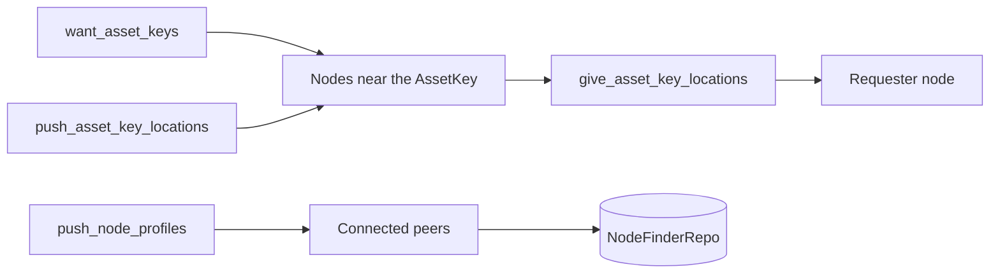

# NodeFinder design

## 1. About this document

This document covers the design of NodeFinder, which exchanges the location information of nodes and finds the nodes that advertise an AssetKey.
Term definitions are the source of [terms.md](../terms.md).

### 1.1 Division of responsibilities among documents

| Document or source of truth | Owns |
| --- | --- |
| [design.md](../design.md#11-division-of-responsibilities-among-documents) | Overall structure, boundaries with other concerns, cross-cutting dependencies |
| This document | NodeFinder lookup, information propagation, distance calculation, persistence |
| [file-transfer.md](./file-transfer.md#2-responsibilities-and-boundaries) | Publishing and subscribing to files using lookup results |
| [node_finder.rs](../../daemon/modules/engine/src/core/negotiator/node/node_finder.rs) | NodeFinder implementation |
| [node_finder_repo.rs](../../daemon/modules/engine/src/core/negotiator/node/node_finder_repo.rs) | Persistence of known nodes |

### 1.2 Tenses used in this document

The body describes the completed design.
The implementation status and remaining work are consolidated in §7.

## 2. Responsibilities and boundaries

NodeFinder handles the exchange of known nodes and the location information of nodes that advertise an AssetKey.
A request is conveyed with only the AssetKey and does not carry the requester's NodeProfile, so NodeFinder returns only the nodes that advertise that AssetKey.
Which assets to advertise is decided by the higher-level component.
Because FileExchanger also advertises files being fetched, the location info of a file can include nodes that hold only some of the blocks (see [file-transfer.md](./file-transfer.md#subscriptions-are-advertised-as-locations-from-the-start)).
NodeFinder does not interpret the content of an asset and returns only the AssetKey-to-NodeProfile mapping.
FileExchanger uses this boundary, so lookup messages and file transfer messages are not mixed.

[NodeProfileFetcher](../../daemon/modules/engine/src/core/negotiator/node/node_profile_fetcher.rs) fetches a set of NodeProfiles for bootstrap from outside.
The URI conversion details and checksum are the source of [protocol/uri.rs](../../daemon/modules/engine/src/protocol/uri.rs).

## 3. Information distribution

NodeFinder propagates requests, answers, and spontaneous advertisements separately.

Requests and advertisements are edged toward nodes close in XOR distance, while answers return to the requester.
Received information is given a lifetime and count limit so old location info and unbounded relay are not retained.

## 4. Separation of decision and communication

[TaskComputer](../../daemon/modules/engine/src/core/negotiator/node/task_computer.rs) looks at the receive state of all Sessions and the requests of higher-level components and computes the next DataMessage to send.
[TaskCommunicator](../../daemon/modules/engine/src/core/negotiator/node/task_communicator.rs) handles only the per-Session handshake and send/receive.
Consolidating the decision into one place keeps routing policy from scattering across per-connection workers.
Sending happens every communication cycle, and reception also waits out the rest of the communication cycle after processing each item.
The wait comes after processing, and since the §6.1 receive deadline is updated at message reception, the wait does not extend the deadline.
A peer that sends faster than the cycle is prevented from making the receiving side repeat persistence work.

The boundary that receives the needed AssetKeys from FileExchanger uses [FnHub](../../daemon/modules/engine/src/base/sync/fn_hub.rs).
Separating the firing side from the registration side lets NodeFinder avoid referencing FileExchanger's concrete type.

## 5. Distance and persistence

[Kadex](../../daemon/modules/engine/src/core/negotiator/node/kadx.rs) compares the XOR distance between an AssetKey's hash and a NodeProfile's ID and chooses the closer nodes.
Because the byte order of the distance calculation affects protocol interoperability, a separate implementation must promote the rule in the code to an external specification.

[NodeFinderRepo](../../daemon/modules/engine/src/core/negotiator/node/node_finder_repo.rs) persists known nodes in SQLite as URI strings.
Storing a URI as an opaque value avoids changing the table schema on every format addition, but address-level SQL search is not possible.

## 6. Design decisions

### 6.1 Decided

The separation of NodeFinder and FileExchanger is the source of [design.md](../design.md#51-decided).

#### Keep the Session established by the smaller node ID when duplicates occur

**Decision**
When a Session with the same peer is duplicated, the Session established by the side with the smaller node ID is kept.
If the Session to keep finishes its handshake later, the earlier-registered Session is closed and swapped out.

**Rationale**
TaskConnectors of the same node reserve their connecting peer, so a duplicate happens when two nodes connect to each other simultaneously.
A rule that keeps the Session that finished the handshake first can make both sides keep different Sessions.
Because one side closing the connection is also the Session kept by the other, both Sessions close, and the dialer stays with the peer recorded as connected and does not reconnect.
Since the node ID is derived from the public key verified in the Session's signature, both sides choose the same Session with the same rule without an extra message.

**Rejected**
A design where the side that detects the duplicate notifies the peer and agrees on which Session to keep needs new messages and state transitions on top of the Session, so it is not taken.

#### The local NodeProfile carries the addresses decided at startup

**Decision**
The local NodeProfile carries the addresses of the setting `p2p.advertise_addrs` when present.
Without the setting, it carries the listen address when listening on a specific address, and when listening on an unspecified address, the reachable local IPs and UPnP external IPs with the listen port appended.
UPnP is used only when enabled by the setting `p2p.use_upnp`.
The addresses are decided once at startup, and an IP change is reflected by restarting.
If more than 8, they are truncated to the first 8 with a warning logged, and startup continues.
The NodeProfile signature is made once, after the addresses are decided and truncated.

**Rationale**
Because the decision uses only what the node knows itself, no message needs to be added to the handshake.
When listening on `0.0.0.0` or behind a NAT without UPnP, a reachable address cannot be decided automatically, so the explicit setting is preferred.
Because UPnP changes the router's port-forwarding configuration, it runs only when chosen by the user.

**Rejected**
A design that has the connection target return the source address it saw through the handshake can learn the address outside the NAT, but it adds a handshake message and needs a way to verify the peer's report, so it is not taken.

#### NodeFinder receive deadline

**Decision**
NodeFinder closes a Session when it receives no message from the peer, including the Hello/Profile exchange, for 3 times the communication cycle.
The communication cycle is taken from `NodeFinderIntervals::communicate`; with the default of 20 seconds the receive deadline is 60 seconds.
The deadline is updated on each Hello, Profile, and DataMessage reception and is not extended by the local node's sends.
After establishment, a DataMessage is always sent every communication cycle, even when empty.
Shutdown ends the send/receive task with the cancellation token without waiting for the receive deadline, and waits for its termination.

**Rationale**
Since the peer sends a DataMessage every cycle, a 3-cycle grace period still prevents an unresponsive Session from permanently occupying connection resources.
Deriving the deadline from the communication cycle keeps the ratio of grace to send frequency even when the cycle setting changes.
Applying it to the Hello/Profile exchange also closes connections that finish Session authentication and use selection but then do not respond.

#### Element counts of DataMessage and NodeProfile

**Decision**
The element counts of DataMessages sent and received are kept within the following ranges.

| Target | Limit per message |
| --- | --- |
| `push_node_profiles` | 32 |
| `want_asset_keys` | 1024 |
| `give_asset_key_locations` | 1024 |
| `push_asset_key_locations` | 1024 |
| NodeProfiles per AssetKey | 8 |
| NodeProfile `addrs` | 8 |

The receiving side checks the limits right after reading the element count, before allocating a Vec or HashMap, and closes the Session of an over-limit message.
The NodeProfile address count is checked at wire decode, so it also applies to the ProfileMessage after Hello.
The `axus:node/...` URIs used for configuration and persistence also follow the same generated NodeProfile constraints and signature verification.
The sending side randomly narrows candidates with the existing rng and stays within each limit.
After the count narrowing, candidates that fit the byte budget of [rocketpack.md](./rocketpack.md#alternating-candidate-types-within-the-size-budget) are chosen.
The receive state holding multiple messages' worth has its own TTL and aggregation count limits.

**Rationale**
Not only the byte count of a frame but also the element counts and the spread of location info are limited, curbing the receiving side's allocations, processing, and the resources consumed by relay.
The 32 known nodes are the same value as the old post-reception truncation, and along with the other limits they are moved to the decode input boundary.
Keeping the sending side within the same limits avoids assembling messages the peer would reject.
Random selection when narrowing the count reduces the bias of always propagating the same candidates.

#### Known nodes keep the newest NodeProfile per node ID

**Decision**
NodeFinderRepo keeps one NodeProfile per node ID.
When a NodeProfile of the same node ID is received, it replaces the held value only when its update time is greater; an equal or smaller value is ignored.
Replacement does not change the row's weight.
The signature mechanism is the source of [trust-security.md](./trust-security.md#nodeprofile-binds-reachable-addresses-with-the-nodes-own-signature).

**Rationale**
Using the whole URI as a key leaves a separate row every time the same node's addresses change, increasing connection attempts to unreachable addresses.
With a signed NodeProfile, a larger update time can be verified as the owner's newer reachable addresses, so the node ID can be the key and only the newer value kept.
The weight is the priority attached to a NodeProfile's origin and does not change as reachable addresses update.

**Rejected**
Keeping the URI as the key and returning only the newest value per node ID at read time avoids changing the storage format, but the old rows keep consuming the count limit.

### 6.2 Deferred

#### NodeFinder active lookup and redundancy

**Current state**
Location info is gathered by periodic propagation, and lookup scans the receive state of connected Sessions.

The candidates are the following two.

1. Adding Kademlia-style iterative queries controls reachability and latency, but adds query state, timeouts, and concurrency.
2. Keeping only propagation keeps the protocol simple, but the time until information arrives and non-delivery are harder to control.

**Why not decided yet**
Because lookup reachability and latency at real operating scale have not been measured.

**Decision condition**
Decide once the reachability and latency needed to start a subscription are measured in a multi-hop integration test.

## 7. Current status and remaining work

The connection, accept, computation, and communication tasks and the SQLite repo exist, and lookup scans only the receive state of connected Sessions.
A two-node integration test starting from AxusService's startup path confirms Session establishment and AssetKey lookup.
Each task's cycle is specified by NodeFinderOption, and the integration test uses short cycles.
The Hello/Profile exchange and post-establishment receive deadlines are derived from the communication cycle and close unresponsive Sessions.
Tests confirm the periodic send of empty DataMessages, deadline updates on reception, and shutdown during a receive wait.
DataMessage and NodeProfile element counts are checked at decode before allocation, and over-limit Sessions are closed.
TaskComputer narrows candidates randomly within the same limits, and the local node's addresses are kept at 8 or fewer at startup.
Tests confirm accepting exactly at limits, disconnecting on each over-limit, round trips between nodes with large information, and URI compatibility within limits.
DataMessage encoded results are limited to 256 KiB or less, and candidates of each kind are selected alternately.
A byte-length violation of an explicit setting is rejected before the worker starts, and a stored non-conforming URI is skipped with a warning. Tests also confirm the DB rows are kept.
NodeProfile is signed, and a NodeProfile received in a DataMessage whose update time is ahead by more than the tolerance is discarded.
Known nodes keep one entry per node ID and replace it only with newer NodeProfiles. A URI with an invalid signature is also skipped as a non-conforming URI.

Duplicate Session resolution is confirmed by a two-node integration test that names each other as bootstrap.
An integration test confirms that a NodeProfile obtained by lookup contains the addresses the peer advertised.
The daemon starts with the NodeProfiles of the setting `p2p.bootstrap_nodes` added to the known nodes.
A three-node integration test confirms finding a node that was not named as a bootstrap through a relay node and connecting to it directly at the advertised address.

The reachability and latency of multi-hop lookup at real operating scale are to be measured, and the active lookup and redundancy are to be decided.

For confirmed bugs, see [issues.md](../issues.md).