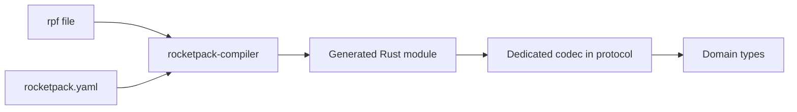

# Design of RocketPack types

## 1. About this document

This document covers the source of truth for types encoded with RocketPack, the generated artifacts, and the migration conventions from hand-written implementations.
Term definitions are the source of [terms.md](../terms.md).

### 1.1 Division of responsibilities among documents

| Document or source of truth | Owns |
| --- | --- |
| [design.md](../design.md#11-division-of-responsibilities-among-documents) | Overall structure, boundaries with other concerns, cross-cutting dependencies |
| This document | Design of the RocketPack type generation Axus adopts and its migration |
| [rocketpack-compiler.md](../../daemon/refs/core-rs/docs/design/rocketpack-compiler.md) | Syntax of `rocketpack.yaml`, references to external types, structure of the generated module |
| [core-rs DESIGN.md](../../daemon/refs/core-rs/docs/DESIGN.md#5-rocketpack) | RocketPack length constraints and decode-time checks |
| [rocketpack-compiler](../../daemon/refs/core-rs/entrypoints/rocketpack-compiler) | compiler implementation |
| [rocketpack-compiled-example](../../daemon/refs/core-rs/entrypoints/rocketpack-compiled-example) | Example of compiler configuration and generated artifacts |
| `.rpf` files | Source of truth for types, field numbers, and external type references |

### 1.2 Tenses used in this document

The body describes the completed design.
The implementation status and remaining work are consolidated in §6.

## 2. Responsibilities and boundaries

Axus makes the rpf the source of truth for communication types and generates the Rust type declarations and `RocketPackStruct` implementations.
Types that can be handled as generated types directly, such as AssetKey, FileRef, and MerkleLayer, use the generated types.
When the Rust representation differs, such as NodeMessage's `Arc` and `HashMap`, or NodeProfile's `OmniAddr` and ID cache, a hand-written domain type is kept separately.
The domain types do not implement `RocketPackStruct`; the dedicated codec in the [protocol module](../../daemon/modules/engine/src/protocol) handles conversion to and from the generated types and encoding/decoding.
The integer enums and nonce arrays of Session also keep a correspondence with generated types in the dedicated codec.
The compiler's internal design belongs to `core-rs`; this document covers only the inputs, outputs, and migration conventions as seen from Axus.

## 3. Inputs and outputs of generation

Concentrating the definitions into a single rpf removes the need to keep the field number correspondence between the encode side and the decode side by hand.
The inputs are [rpfs](../../daemon/rpfs) and [rocketpack.yaml](../../daemon/rocketpack.yaml), and the outputs are [generated.rs](../../daemon/modules/engine/src/generated.rs) and a same-named directory included in the engine's crate root.
The generated artifacts are version-controlled, and the compiler is not run in a normal build.
[gen-rocketpack.sh](../../daemon/gen-rocketpack.sh) runs the compiler from the core-rs workspace and places the target under `AGENT_TEMP_DIR`.
The syntax of `rocketpack.yaml`, the structure of the generated module, and where artifacts go are the source of [rocketpack-compiler.md](../../daemon/refs/core-rs/docs/design/rocketpack-compiler.md).

## 4. Migration of the wire format

The fields of rpf structs and the variants of enums carry a `@N` number, and this N is the field number on the wire.
An `Option<T>` field omits its key from the map when the value is `None`, and the element count is counted accordingly.
A receiver that gets an unknown number skips that field and continues decoding the rest.
Migration assumes the `Option` omission and skipping unknown fields, so hand-written implementations and generated artifacts can decode each other even when the set of fields differs.
Length constraints and decode-time checks are the source of [core-rs DESIGN.md](../../daemon/refs/core-rs/docs/DESIGN.md#5-rocketpack).

The invariant of migration is not changing the wire format.
Field numbers used by the hand-written implementation are mapped to `@N` as-is, and field renumbering or unifying the numbering rules is not done at the same time.
A type's declaration and codec are not split between hand-written and generated; each type has one source of truth.
Because the rpf can express element-count and byte-length limits on a type, a migrated type can enforce the limits at decode time.
Accept that the generated pack also checks the same limits at send time.

A multi-element map is encoded from the generated type's `BTreeMap`, so its traversal order differs from the `HashMap` the earlier hand-written type used.
The receiving side does not depend on map order, so this is tolerated; single-element maps and the other communication types stay byte-fixed.
The accepted range of NodeProfile URIs is changed per the decision in §5.1.

## 5. Design decisions

### 5.1 Decided

#### Generate RocketPack types from the rpf

**Decision**
Types encoded with RocketPack make the rpf the source of truth, and the Rust type declarations and `RocketPackStruct` implementations are generated.
The generated artifacts are not hand-edited; changes to types and field numbers are made only in the rpf.

**Rationale**
With hand-written code, pack and unpack handle the same field numbers in separate places, and a mismatch is not detectable through types.
Concentrating the definitions in one place also leaves room to add generation targets for languages other than Rust later.

**Rejected**
Continuing hand-written `RocketPackStruct` implementations leaves traces of adoption in existing code, but since the source of truth for the types would be scattered across implementations, it is not adopted.

#### OmniAddr is a string, with conversion in Axus

**Decision**
In Axus's rpf, OmniAddr is a string, and the conversion to and from the domain type lives in the dedicated codec for NodeProfile.
OmniHash and OmniCert reference the omnikit manifest as a dependency. core-rs is not changed.

**Rationale**
To keep the representation that the current NodeProfile encodes as a string and to keep the responsibility for Axus's communication representation in Axus.
The conversion uses `as_str` and `OmniAddr::from`, and adds no parsing or normalization.

**Rejected**
Adding an OmniAddr schema for Axus to core-rs would move the responsibility for Axus's communication format into a dependency, so it is not adopted.

#### Unify the NodeProfile URI and network acceptance limits

**Decision**
NodeProfileUri is removed, and the same generated NodeProfile is used for the URI and the network.
`addrs` is at most 8 entries in both, and the pack also follows the generated codec's limit checks.
Compatibility with existing URIs containing 9 or more addresses is dropped, and decode failures are accepted.
Encoding to a URI has `NodeProfile::to_uri` return `Result<String>`, and a limit overflow is handled by the caller.

**Rationale**
To avoid two schemas and acceptance ranges for the same NodeProfile and to unify on the more restrictive one.
Because returning `Display`'s `fmt::Error` from `to_string` panics, URI generation is exposed as a dedicated method.

**Rejected**
Keeping an unlimited schema and codec for URIs prioritizes schema unification over compatibility with existing URIs, so it is not adopted.

#### Separate domain types and communication types only where needed

**Decision**
Types that can directly handle the generated type get hand-written behavior added.
When a domain type is kept separately, the conversion is explicit in a dedicated codec, and `RocketPackStruct` is removed from the domain type.

**Rationale**
To avoid duplicating every type while keeping Rust-side representations such as shared ownership, caches, and enums.

**Rejected**
Leaving a thin `RocketPackStruct` implementation on the domain types violates the policy of making the conversion between domain values and communication representations explicit at the send and receive sides, so it is not adopted.

#### Accept map order changes and send-time checks

**Decision**
NodeFinder's messages were also switched to the generated type. The order change of multi-element maps is tolerated as the exception in §4.
The existing count limits are written into the schema, and it is accepted that the generated pack also rejects over-limit values at send time.
The byte-length limit and the variable-length field limits follow the next decision.

**Rationale**
To consolidate the source of truth for the codec into the rpf while keeping the receiving side's map interpretation and the existing count limits.

#### Limit NodeFinder byte lengths at V1 input boundaries

**Decision**
NodeFinder's frame payload and the encoded result of a NodeMessage are at most 256 KiB.
A public key is at most 256 bytes, one address's UTF-8 representation 512 bytes, and an AssetKey's kind 64 bytes.
The per-field constraints and the overall size constant live in the rpf, and the overall size is enforced by the frame layer and the dedicated codec.
The existing count limits are kept, but combinations within the count that exceed the byte length are rejected.
Applied to V1, and wire formats within the limits are kept. Over-limit old messages and URIs are not accepted.

**Rationale**
Counts alone cannot limit the receive-side memory consumed by variable-length values and duplicate NodeProfiles.
Lowering the frame limit itself also constrains the buffer before decoding.

**Rejected**
A 1 MiB limit can propagate a lot of information at once, but constraining the per-connection receive memory is prioritized, so it is not taken.
Adding a version adds negotiation and migration paths, so compatibility with over-limit data is dropped and V1 is applied instead.

#### Alternating candidate types within the size budget

**Decision**
Send candidates are narrowed by count and then chosen alternately from node info, requests, responses, and location propagation.
The candidate order and the kind chosen first are randomized, and only candidates whose encoded size fits the budget are adopted.
A location's AssetKey and its NodeProfile set are treated as one unit, and the encoded size and the collection headers are accounted for.
Candidates that fall out of the budget are reconsidered in the next computation cycle; completing the send of all candidates is not guaranteed.

**Rationale**
To prevent a single kind of large information from depriving other information of send opportunities, and to manage candidates with the same lifetime as the current random count selection.

**Rejected**
Prioritizing responses delays requests and location propagation, so it is not taken.
An unsent queue adds management of capacity, deadlines, and candidate updates, so it is not taken.

#### Reject configuration violations and skip stored non-conforming URIs

**Decision**
A byte-length violation of an explicit bootstrap URI or of the local node causes a rejection with a reason at startup.
Stored non-conforming URIs are skipped with a warning, and the DB rows are kept.
Address strings are not truncated. The existing handling that trims the local node's address count to 8 is kept.

**Rationale**
To return configuration errors to the user while not stopping the whole daemon just because a record of an unusable known node exists.
Truncating strings would change the meaning of the connect target, and deleting DB rows would lose stored information, so neither is taken.

## 6. Current status and remaining work

The migration to generated types and dedicated codecs is complete.
Regeneration reproducibility, compatibility with the old codec, and the URI boundaries and send/receive count limits are verified.

NodeFinder's frame and NodeMessage encoded results are limited to 256 KiB or less.
Field limits are checked by the generated pack/unpack, and the overall limit by the frame layer and the dedicated codec.
The encoded size of a test fixture combining the maximum-count and maximum-length fields is 72,386,544 bytes, and this combination is rejected at send time.
TaskComputer adopts candidates of each kind alternately after the count selection and fits them within the size budget.
Byte-length boundaries, multi-byte characters, the selection of many candidates and round trips, the rejection of configuration violations, and the retention of stored DB rows are confirmed by tests.
For known bugs, see [issues.md](../issues.md).
