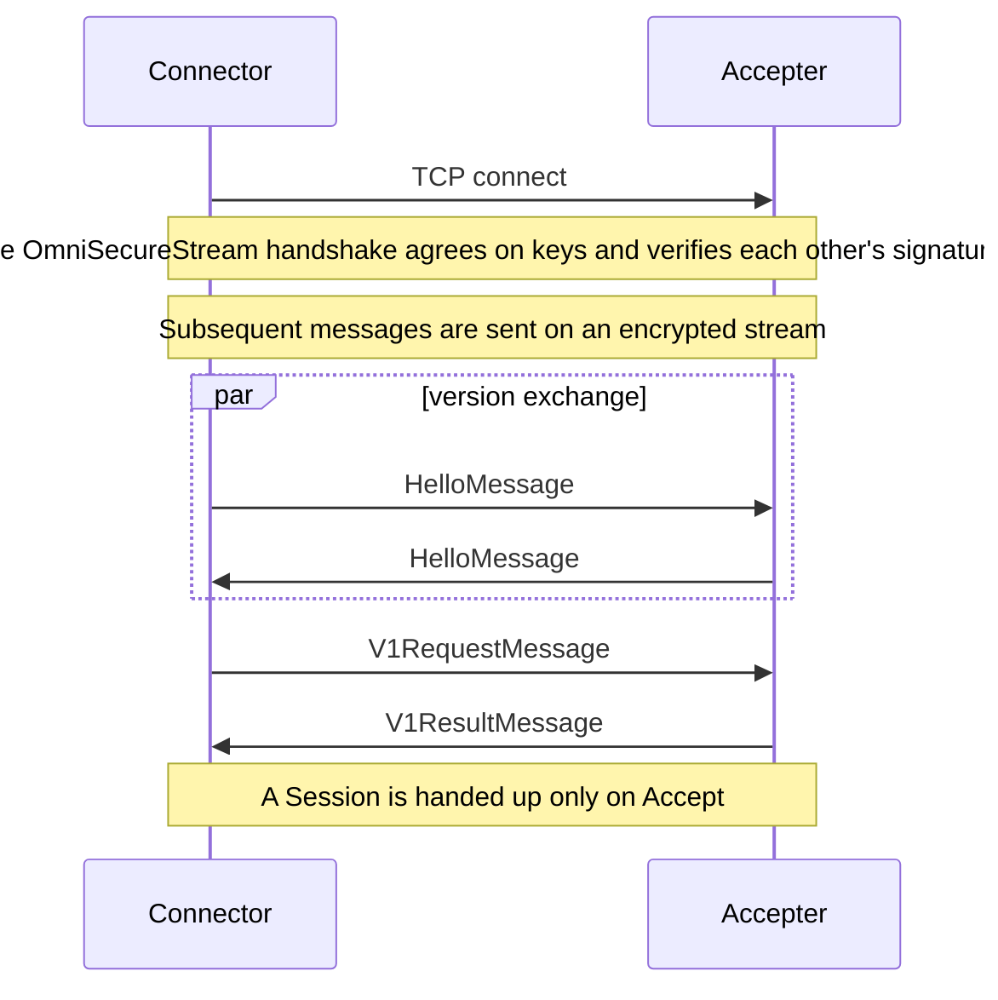

# Design of transport and Session

## 1. About this document

This document covers the procedure for assembling a TCP connection into a Session, use separation, and the shutdown contract.
Term definitions are the source of [terms.md](../terms.md).

### 1.1 Division of responsibilities among documents

| Document or source of truth | Owns |
| --- | --- |
| [design.md](../design.md#11-division-of-responsibilities-among-documents) | Overall structure, boundaries with other concerns, cross-cutting dependencies |
| This document | transport, Session establishment, use separation, shutdown |
| [trust-security.md](./trust-security.md#2-responsibilities-and-boundaries) | What Session authenticates and the security boundary it does not guarantee |
| [core/session](../../daemon/modules/engine/src/core/session) | Session protocol implementation |
| [core-rs DESIGN.md](../../daemon/refs/core-rs/docs/DESIGN.md#62-secure-connection) | Structure of the `OmniSecureStream` handshake, key derivation, frame encryption |
| [base/connection](../../daemon/modules/engine/src/base/connection.rs) | TCP connection and framed stream implementation |

### 1.2 Tenses used in this document

The body describes the completed design.
The implementation status and remaining work are consolidated in §6.

## 2. Responsibilities and boundaries

The Session layer authenticates a connection, assigns it to one use, and hands it to the higher-level component.
The messages of NodeFinder and FileExchanger are interpreted by each protocol layer.

## 3. Connection and establishment

[connection](../../daemon/modules/engine/src/base/connection.rs) hides TCP acceptance and dialing behind a trait.
The dialing side handles plain TCP and SOCKS5 proxy at the same boundary, and the accepting side handles UPnP port mapping when needed.
The Session layer protects the byte stream received from connection with core-rs's `OmniSecureStream` and places `FramedStream` on top.
The higher layers use only the length-delimited message stream that `FramedStream` provides, not the connection method.

RocketPack encoding and decoding pass through the extension in [framed.rs](../../daemon/modules/engine/src/base/connection/stream/framed.rs).
This lets the session and negotiator avoid handling TCP partial reads and message boundaries.

The dialing side and the accepting side agree on the secure channel, the version, and the use in that order.

Because version and use are exchanged after encryption, a third party can neither read nor rewrite the negotiation.
Placing the use determination after authentication keeps unauthenticated connections out of the NodeFinder and FileExchanger queues.
The version negotiation must select only the procedures that both sides support in common.
The Session handshake spans from after the TCP connection to the completion of the secure channel and use selection, with the deadline, concurrency, and frame limits restricted per §5.1.
The NodeFinder Hello/Profile exchange happens afterwards in the higher-level protocol.
This exchange and post-establishment reception apply a deadline of 3 times the communication cycle, and [node-finder.md](./node-finder.md#61-decided) is the source of truth for the details.

## 4. Uses and shutdown

One Session is assigned to either NodeFinder or FileExchanger (§5.1).
Because multiplexing across uses is not introduced into the session layer, each higher-level protocol processes only its own messages.

[Shutdown](../../daemon/modules/engine/src/base/runtime/shutdown.rs) is the common contract for stopping owned lower-level components in order.
A worker exits itself when its cancellation token is cancelled, and shutdown waits for the termination of the join handle.
Because futures are not aborted from outside with `abort`, a worker does not outlive its owner's lifetime, and the shutdown cleanup always runs.

## 5. Design decisions

### 5.1 Decided

#### Assign one Session to one use

**Decision**
NodeFinder and FileExchanger use separate Sessions and each have an accept queue and connection limits for their use.

**Rationale**
To isolate message protocols and connection resources per use so that the load of one does not monopolize the other's processing.

#### Handshake deadline and concurrency

**Decision**
The accepting and dialing sides set one 10-second deadline over the whole handshake after the TCP connection and close connections that exceed it.
The deadline is not extended by the secure channel, version, or use exchanges.
The accepting side progresses handshakes per connection in parallel and limits the concurrency to 64.
Connections over the limit are closed without reading or writing and are logged.
Shutdown also cancels handshake tasks with the cancellation token and waits for their termination.

**Rationale**
To limit how long a non-responding peer can occupy accepting and dialing, and to curb connection-resource consumption by unauthenticated peers.
Processing per connection keeps one unresponsive connection from stopping other handshakes.
The concurrency limit also prevents a large number of tasks and streams from lingering until the deadline.

**Rejected**
A design where a few workers process handshakes serially is not adopted because an unresponsive connection would occupy a worker and prevent accepting the next connection.

#### Frame limits by use

**Decision**
Frames during the handshake are at most 16 KiB in both directions.
After use selection, the limit switches to 256 KiB for NodeFinder and, for FileExchanger, the maximum block length of 1 MiB plus the hash and tag carried in the block message.
A Session whose received frame exceeds the limit is closed.
The post-establishment receive deadline of FileExchanger is the source of [file-transfer.md](./file-transfer.md#53-state-messages-and-session-lifetime).

**Rationale**
To lower the limit to the range needed by pre-authentication messages and to curb the memory the receiving side reserves for frames.
NodeFinder also consumes resources receiving propagated information, so it holds a 256 KiB limit after establishment.
The largest message FileExchanger sends carries one block, so the limit is derived from the maximum block length (see [file-transfer.md](./file-transfer.md#set-the-maximum-block-length-to-1-mib)).

#### Post-establishment receive deadline

**Decision**
FramedStream holds a receive deadline, and the owner of each use sets it right after the Session is established.
NodeFinder sets 3 times the communication cycle and FileExchanger sets 30 seconds, and a `recv_message` that exceeds it returns an error.
The deadline is not extended by the local node's sends.
A Session that finished the handshake but is not taken by `accept` within 10 seconds, the same as the handshake deadline, is discarded.

**Rationale**
A receive without a deadline leaves a task waiting forever for a silent peer, and a caller that forgets to apply one reproduces the problem individually.
Holding the deadline in the stream next to the per-use frame limit makes a receive without a deadline impossible on an established Session.
The value stays with the owner of the use because it derives from that use's send cycle (see [NodeFinder receive deadline](./node-finder.md#nodefinder-receive-deadline) and [file-transfer.md](./file-transfer.md#53-state-messages-and-session-lifetime)).

**Rejected**
Holding a per-use deadline in `SessionOption` makes the session layer know each use's send cycle and duplicates NodeFinder's cycle setting.
Leaving the deadline to each caller made each use responsible for applying it, which is how the FileExchanger Session came to have none.

#### Element counts of NodeFinder messages

**Decision**
On top of the frame limit, NodeFinder uses the following element counts as the send/receive limits.

| Target | Limit per message |
| --- | --- |
| `AnnounceProfiles` NodeProfiles | 32 |
| `AnnounceLocations` AssetKeys | 1024 |
| `LookupResponse` locations | 8 |
| `LookupResponse` closer nodes | 8 |
| NodeProfiles per AssetKey | 8 |
| NodeProfile `addrs` | 8 |

A message over the limit is rejected at decode right after reading the element count, before allocating the collection, and the Session is closed.
NodeProfile `addrs` is checked at wire decode and also applies to NodeFinder's ProfileMessage.
URIs follow the same generated NodeProfile constraints, and the local node's addresses are truncated to 8 at startup before signing, with a warning logged.
Candidate narrowing and the handling of aggregate information are the source of [node-finder.md](./node-finder.md#61-decided).

**Rationale**
The frame limit alone still allows many collections and location entries per message, so the allocation and processing amounts on the receiving side are also limited by element count.
Keeping the sending side within the same limits prevents the peer from closing the Session over the count.

#### Secure channel of the Session

**Decision**
A Session encrypts the TCP byte stream with core-rs's `OmniSecureStream` and requires the peer's signature from both sides.
Connections that do not send a signature and connections whose signature fails verification are closed.
The four properties Session requires of the `OmniSecureStream` handshake are the following.

- The signature covers a transcript of the handshake that includes a prefix indicating the use, the connection direction, both sides' profiles, and their ephemeral public keys.
- Key derivation depends on the same transcript.
- Both sides exchange a key confirmation with the derived keys before completing the handshake. The key confirmation covers the two sides' signing public keys in addition to the transcript.
- The creation time of the ephemeral public key is included in the transcript, and the receiver rejects handshakes whose difference from its own clock exceeds the tolerance. Session sets the tolerance to 5 minutes.

Session's HelloMessage, use request, and use result are exchanged on the encrypted stream.
The old V1 procedure that exchanged a challenge and a signature is removed, and the V1 contents are replaced without raising SessionVersion.
The handshake messages and key derivation structure are the source of [core-rs DESIGN.md](../../daemon/refs/core-rs/docs/DESIGN.md#62-secure-connection).

**Rationale**
In a scheme that signs only a nonce chosen by the peer, the signature binds to neither the TCP connection nor the keys.
A third party that routes a node's connection to itself relays the handshake to the genuine peer so both authenticate each other, and can then read and write the plaintext afterwards.
Including the ephemeral public key in the signed transcript prevents the third party from substituting a key and obtaining the agreed keys.

Limiting the signed target to the signer's own values leaves another attack.
On relay, a third party can replace the signature with one from its own key and put another node's communication under its own name.
It can also replay a recorded handshake to create a connection that passes authentication.
Replay is detected as a signature verification failure by including a value that the peer picks per connection in the transcript.
Substituting a signature is detected by including both sides' signing public keys in the key confirmation target: the relayed side computes the confirmation with the third party's public key, while the signer computes it with its own, so the two values disagree.

The creation-time check rejects a peer reusing an old signature without depending on any value of the peer.
Replay detection through the transcript depends on the receiver choosing a different value per connection, while the time check also works when that premise breaks.
The cost is that nodes whose clocks skew beyond the tolerance cannot establish a Session.

The prefix prevents a signature for one use from being repurposed for another when the same signing key signs outside of Sessions.
Replacing the V1 contents is because no network has been distributed, and there is no peer that needs compatibility with the old procedure.

**Rejected**
Leaving the `OmniSecureStream` handshake unchanged and reconciling both node IDs put in the use request after encryption prevents name substitution in Axus.
But the weakness stays in the shared library, and other users would each implement the same reconciliation, so it is not adopted.

Defining Session-specific key agreement in Axus has the largest design and audit burden and overlaps the role of core-rs's secure connection, so it is not adopted.

Replacing frame encryption, authenticated shutdown, and key rotation on top of the handshake as well (core-rs [PR #201](https://github.com/omnius-labs/core-rs/pull/201)) makes the design and implementation too complex for the properties Session requires, so it is not adopted.

Keeping the old V1 and adding a new version would keep a relayable procedure and a prefix-less signed target in the implementation while no peer needs compatibility, so it is not adopted.

### 5.2 Deferred

#### Session version selection

**Current state**
[connector.rs](../../daemon/modules/engine/src/core/session/connector.rs), [accepter.rs](../../daemon/modules/engine/src/core/session/accepter.rs), and [task_communicator.rs](../../daemon/modules/engine/src/core/negotiator/node/task_communicator.rs) intersect the version they sent with the one they received and return an `UnsupportedType` error when empty.
NodeFinder's HelloMessage carries the supported versions as a set of bit flags, but Session's HelloMessage in [message.rs](../../daemon/modules/engine/src/core/session/message.rs) carries only one `SessionVersion` and rejects unknown values at decode.
The only defined version is V1, and the rule for choosing one among multiple common versions is not defined.

The candidates are the following two.

1. Choosing the largest numeric common version prioritizes new features, but the version number and the priority must always agree.
2. Choosing from an explicit priority table prioritizes stable versions, but the table must be updated on every version addition.

**Why not decided yet**
Because only V1 exists, both rules produce the same negotiation result.

**Decision condition**
Decide before adding a second version to `SessionVersion` or `NodeFinderVersion`.
If adding to `SessionVersion`, also change the wire format so Session's HelloMessage can carry the set of supported versions.

## 6. Current status and remaining work

The secure channel of §5.1 is implemented.
connection returns a TCP stream, and SessionConnector and SessionAccepter stack `OmniSecureStream` and FramedStream in order.
Both sides require the peer's signature, handshake with a 5-minute tolerated clock difference, and pass the verified peer cert to the Session.
The version and use selection messages are exchanged on the encrypted stream.
A test that records both directions' byte streams confirms that the plaintext of messages sent after establishment does not appear in the TCP byte stream.
A test using loopback TCP confirms that a peer's disconnect is detected as a receive error.
SessionOption's deadline, concurrency, and frame limits are passed to SessionAccepter and SessionConnector and enforced at the handshake input boundary.
The accepting side separates TCP acceptance from per-connection handshake tasks, and shutdown cancels and then waits for all tasks.
The frame limit switch after use selection is also implemented.
FileExchanger's frame limit is the maximum block length of 1 MiB plus 256 bytes, confirmed by tests that the largest block and request messages fit and that a block over 1 MiB is not encoded.
FramedStream holds the post-establishment receive deadline, counted from the last received frame, and NodeFinder and FileExchanger set it with 3 times their cycle.
Tests confirm that a silent peer fails at the deadline, that a received frame restarts it, and that an over-limit frame is reported as an invalid format, which is distinguished from a close or a deadline.
SessionAccepter drops a Session that `accept` takes later than the handshake deadline after its establishment.
It holds one receiver per use behind its own lock, so a FileExchanger accept that waits for a connection does not stop NodeFinder from accepting; a test confirms it.
SessionConnector returns a Session only on Accept, and the dialing sides of NodeFinder and FileExchanger close a Session whose cert key differs from the key of the candidate's NodeProfile.
The wire decode of NodeMessage and NodeProfile checks the element count limits before allocation.
Tests confirm the decode-time rejection of the profile and AssetKey counts and a Session closed by a frame over the limit.
NodeFinder's frame limit is 256 KiB, confirmed by tests sending and receiving at exactly the limit and rejecting over-limit frames.
FileExchanger starts with the daemon, but it advertises and dials nothing until a file is published or subscribed, and the REST API that starts them is not defined yet.
Until multiple-version selection is decided, Profile exchange on an untrusted network is not enabled.

For confirmed bugs, see [issues.md](../issues.md).
